# Prueba de caja blanca 01 — `enviar_flag`

- **Módulo:** `itdb_ctf/core/envio_logic.py`
- **Función:** `enviar_flag(id_usuario, id_reto, id_evento, flag_enviada) -> (bool, str)`
- **Propósito:** validar y registrar el envío de una flag por un estudiante.
- **Técnica:** camino básico (McCabe) + cobertura de ramas con `pytest-cov`.
- **Archivo de pruebas:** `tests/test_01_enviar_flag.py`

---

## 1. Código fuente con nodos numerados

```python
10   def enviar_flag(id_usuario:int, id_reto:int, id_evento:int, flag_enviada:str) -> tuple[bool,str]:
11       ok, faltan = permitir_flag(id_usuario, id_reto)                                                                                    # 1
12       if not ok:                                                                                                                         # 2
13           return False, f"Demasiados intentos. Espera {faltan} s."                                                                       # 3
14       with Session(engine) as s :                                                                                                        # 4
15           reto = s.get(Reto,id_reto)                                                                                                     # 4
16           if not reto or not reto.activo:                                                                                                # 5
17               return False, "Reto no disponible."                                                                                        # 6
18           ev = s.get(Evento, id_evento)                                                                                                  # 7
19           if not ev:                                                                                                                     # 8
20               return False, "Evento no disponible."                                                                                      # 9
21           cont = s.exec(select(Contiene).where(Contiene.id_reto==id_reto,Contiene.id_evento==id_evento)).first()                         # 10
22           if not cont:                                                                                                                   # 11
23               return False, "El reto no pertenece a este evento."                                                                        # 12
24           est_evento = estado_evento(ev)                                                                                                 # 13
25           if est_evento == "futuro":                                                                                                     # 14
26               return False, "El evento aún no ha iniciado."                                                                              # 15
27           if est_evento == "concluido":                                                                                                  # 16
28               return False, "El evento ha finalizado."                                                                                   # 17
29           # --- El usuario debe estar INSCRITO en el evento
30           est_inscrito = s.exec(select(EstadoInscripcion.id_estado_inscripcion).where(EstadoInscripcion.etiqueta=="inscrito")).first()   # 18
31           inscrito = s.exec(select(Participa).where(                                                                                     # 18
32               Participa.id_usuario==id_usuario,                                                                                          # 18
33               Participa.id_evento==id_evento,                                                                                            # 18
34               Participa.id_estado_inscripcion==est_inscrito,                                                                             # 18
35           )).first()                                                                                                                     # 18
36           if not inscrito:                                                                                                               # 19
37               return False, "No estás inscrito en este evento."                                                                          # 20
38           # --- Anti-resubmit
39           resuelto = s.exec(select(Resuelve).where(                                                                                      # 21
40               Resuelve.id_usuario==id_usuario,                                                                                           # 21
41               Resuelve.id_evento==id_evento,                                                                                             # 21
42               Resuelve.id_reto==id_reto,                                                                                                 # 21
43               Resuelve.flag_correcta==True,                                                                                              # 21
44           )).first()                                                                                                                     # 21
45           if resuelto:                                                                                                                   # 22
46               return False, "El reto ya ha sido resuelto."                                                                               # 23
47           correcta=flag_hasher.verificar(flag_enviada,reto.flag)                                                                         # 24
48           s.add(Resuelve(                                                                                                                # 24
49               id_usuario=id_usuario,                                                                                                     # 24
50               id_evento=id_evento,                                                                                                       # 24
51               id_reto=id_reto,                                                                                                           # 24
52               flag_correcta=correcta,                                                                                                    # 24
53           ))                                                                                                                             # 24
54           if correcta:                                                                                                                   # 25
55               s.flush()                                                                                                                  # 26
56               refrescar_puntaje(s, id_reto, id_evento)                                                                                   # 26
57               s.commit()                                                                                                                 # 26
58               canales.publicar_scoreboard(id_evento)   # push tiempo real                                                                # 26
59               return True, "¡Flag correcta!"                                                                                             # 26
60           s.commit()                                                                                                                     # 27
61           return False, "Flag incorrecta."                                                                                               # 27
                                                                                                                                            # 28 (fin)
```

**Condición compuesta.** El `if` de la línea 16 (`not reto or not reto.activo`) une varias condiciones con `or`. En Python, `or` se evalúa en cortocircuito: en cuanto una condición es verdadera, las siguientes no se evalúan. Según Watson y McCabe (1996, §4.1, p. 25), cada operador de cortocircuito suma un nodo de decisión; también permiten representar la condición completa como **un solo nodo predicado** (*"suppressing" short-circuit operators*), siempre que antes se verifique que las condiciones no tienen efectos secundarios (*"unless perhaps it is first verified that the short-circuit boolean expressions do not contain any side effects"*) y que el criterio se aplique de forma consistente.

**Verificación.** Ninguna de las dos condiciones modifica datos ni el estado del programa: `not reto` comprueba si `s.get` devolvió un registro y `not reto.activo` lee un atributo de ese registro. Por eso el `if` se representa como **un solo nodo predicado (5)**, con dos salidas (verdadero / falso) y un único `return` (6). El mismo criterio se aplica a todas las condiciones compuestas de estas pruebas.

Las condiciones simples que hacen verdadero el nodo 5 se prueban como entradas distintas del mismo camino C2 (casos C2a y C2b), para que ninguna quede sin ejecutar al agruparlas en un solo nodo.

**Ajuste del código (Watson y McCabe, 1996, §5.1).** En la versión anterior la
comprobación del evento (`if not ev`) iba *después* de la de `Contiene`. Como
`contiene.id_evento` es clave foránea hacia `evento`, si existía la fila de
`Contiene` el evento también existía y la rama "Evento no disponible." nunca se
podía ejecutar (camino no factible). Se movió la comprobación del evento antes de
la de `Contiene`; los mensajes y el resultado de la función no cambian, y ahora
los 10 caminos son factibles.

## 2. Grafo de flujo

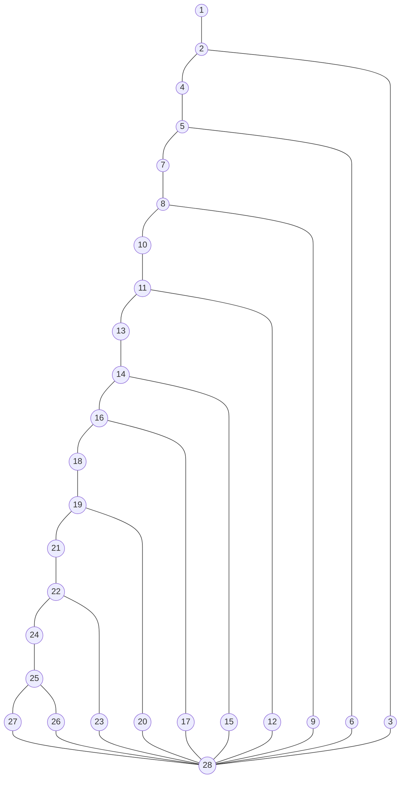

**Convención del grafo:** las aristas no llevan flecha ni etiqueta; el flujo va de arriba hacia abajo y converge en los nodos de unión y en el nodo final (28). De cada nodo predicado salen dos aristas: la de la **derecha** corresponde a la condición **verdadera** y la de la **izquierda** a la **falsa**.

(Para obtener la imagen: pegar el bloque en https://mermaid.live y exportar PNG/SVG.)

## 3. Complejidad ciclomática V(G)

| Método | Cálculo | Resultado |
|---|---|---|
| Nodos predicado | P = 9 (nodos 2, 5, 8, 11, 14, 16, 19, 22, 25) → V(G) = P + 1 | **10** |
| Aristas y nodos | E = 36, N = 28 → V(G) = E − N + 2 = 36 − 28 + 2 | **10** |
| Regiones | 9 regiones cerradas + 1 exterior | **10** |

Hay **10 caminos independientes**.

## 4. Caminos independientes

| Camino | Recorrido | Descripción |
|---|---|---|
| C1 | 1 → 2(verdadero) → 3 → 28 | Superó el límite de envíos |
| C2 | 1 → 2(falso) → 4 → 5(verdadero) → 6 → 28 | Reto no disponible (no existe o está inactivo) |
| C3 | … → 5(falso) → 7 → 8(falso) → 10 → 11(verdadero) → 12 → 28 | El reto no está asociado al evento |
| C4 | … → 5(falso) → 7 → 8(verdadero) → 9 → 28 | El evento no existe |
| C5 | … → 11(falso) → 13 → 14(verdadero) → 15 → 28 | El evento aún no inicia |
| C6 | … → 14(falso) → 16(verdadero) → 17 → 28 | El evento ya finalizó |
| C7 | … → 16(falso) → 18 → 19(verdadero) → 20 → 28 | El usuario no está inscrito (o está descalificado) |
| C8 | … → 19(falso) → 21 → 22(verdadero) → 23 → 28 | El usuario ya resolvió ese reto |
| C9 | … → 22(falso) → 24 → 25(verdadero) → 26 → 28 | Flag correcta |
| C10 | … → 25(falso) → 27 → 28 | Flag incorrecta |

Todos los caminos son factibles.

### 4.1 Grafo de cada camino

En cada grafo se resalta en naranja el recorrido del camino (nodos y
aristas); el resto del grafo queda en gris como referencia. Cada nodo
(círculo) es una sentencia o grupo de sentencias, numerado según el código
de la sección 1; el nodo 28 es el nodo final. Se usa la misma convención de la
sección 2 (derecha = verdadero, izquierda = falso); en el recorrido escrito bajo cada
grafo, `(verdadero)`/`(falso)` indica la salida que toma cada nodo predicado.

**C1 — Superó el límite de envíos**

`1 → 2(verdadero) → 3 → 28`

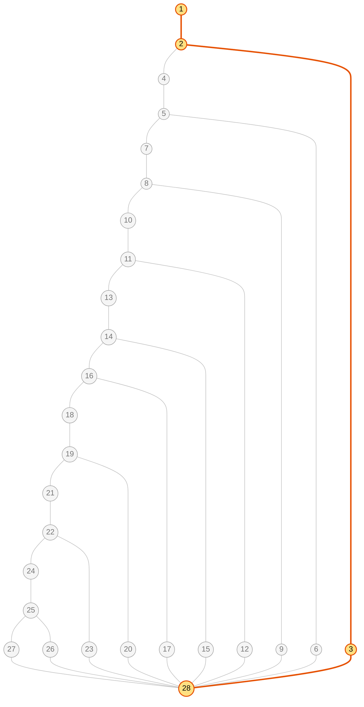

**C2 — Reto no disponible (no existe o está inactivo)**

`1 → 2(falso) → 4 → 5(verdadero) → 6 → 28`

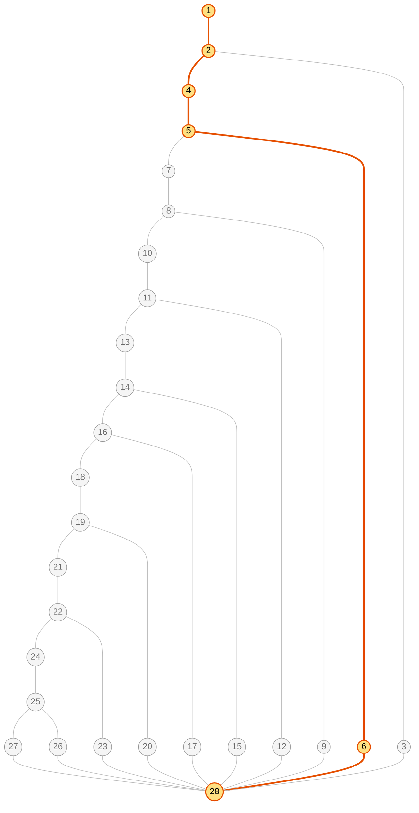

**C3 — El reto no está asociado al evento**

`1 → 2(falso) → 4 → 5(falso) → 7 → 8(falso) → 10 → 11(verdadero) → 12 → 28`

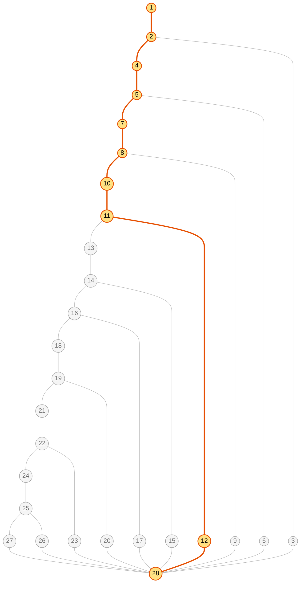

**C4 — El evento no existe**

`1 → 2(falso) → 4 → 5(falso) → 7 → 8(verdadero) → 9 → 28`

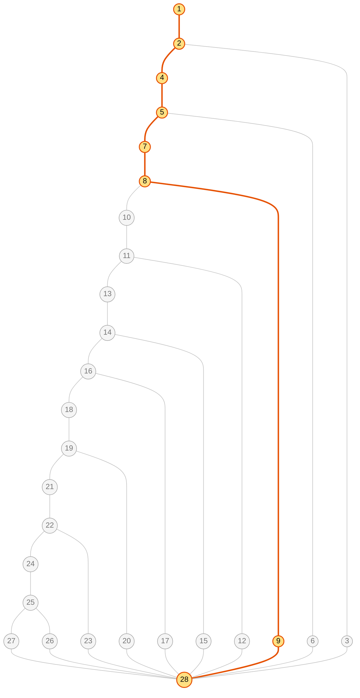

**C5 — El evento aún no inicia**

`1 → 2(falso) → 4 → 5(falso) → 7 → 8(falso) → 10 → 11(falso) → 13 → 14(verdadero) → 15 → 28`

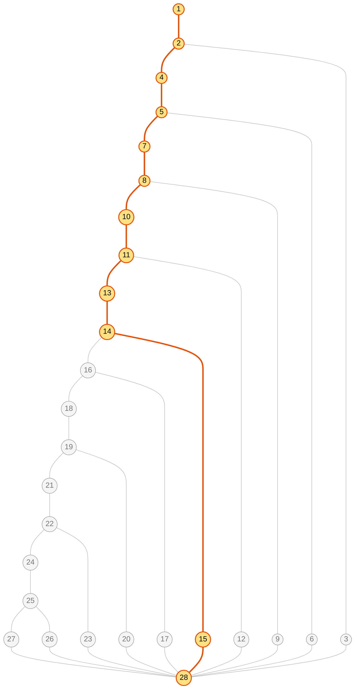

**C6 — El evento ya finalizó**

`1 → 2(falso) → 4 → 5(falso) → 7 → 8(falso) → 10 → 11(falso) → 13 → 14(falso) → 16(verdadero) → 17 → 28`

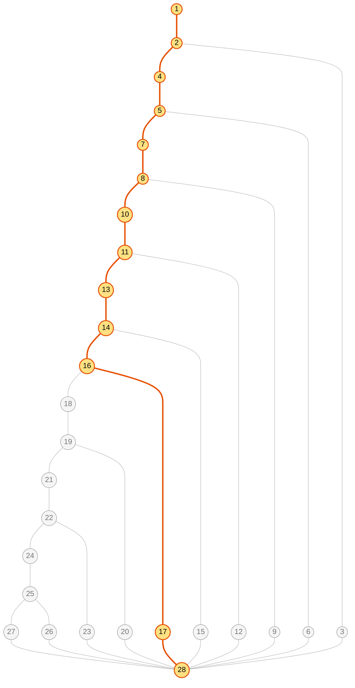

**C7 — El usuario no está inscrito (o está descalificado)**

`1 → 2(falso) → 4 → 5(falso) → 7 → 8(falso) → 10 → 11(falso) → 13 → 14(falso) → 16(falso) → 18 → 19(verdadero) → 20 → 28`

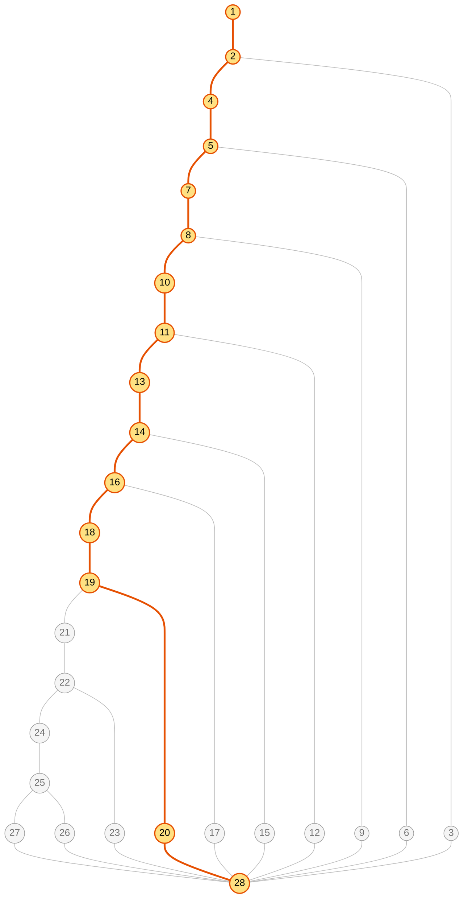

**C8 — El usuario ya resolvió ese reto**

`1 → 2(falso) → 4 → 5(falso) → 7 → 8(falso) → 10 → 11(falso) → 13 → 14(falso) → 16(falso) → 18 → 19(falso) → 21 → 22(verdadero) → 23 → 28`

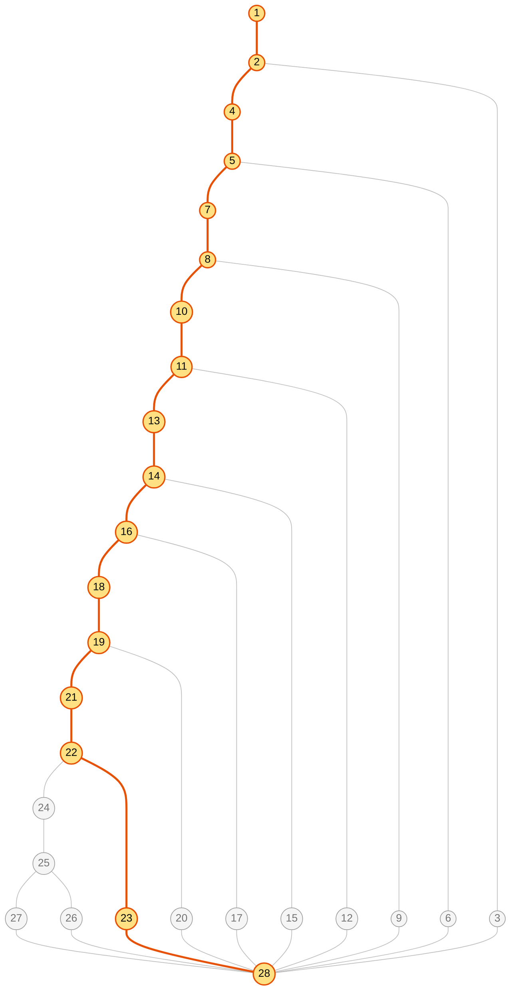

**C9 — Flag correcta**

`1 → 2(falso) → 4 → 5(falso) → 7 → 8(falso) → 10 → 11(falso) → 13 → 14(falso) → 16(falso) → 18 → 19(falso) → 21 → 22(falso) → 24 → 25(verdadero) → 26 → 28`

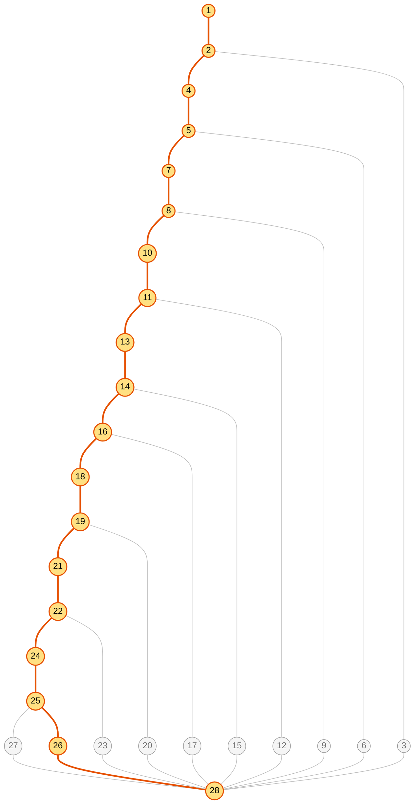

**C10 — Flag incorrecta**

`1 → 2(falso) → 4 → 5(falso) → 7 → 8(falso) → 10 → 11(falso) → 13 → 14(falso) → 16(falso) → 18 → 19(falso) → 21 → 22(falso) → 24 → 25(falso) → 27 → 28`

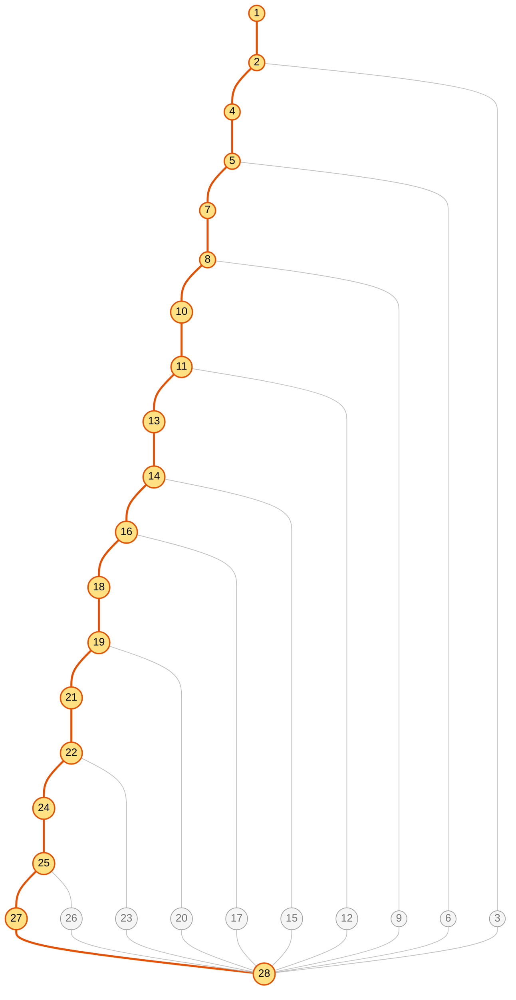
## 5. Casos de prueba

Escenario base (lo arma la fixture `escenario`): un evento cerrado **activo**
(inició ayer, termina mañana), un reto activo con flag `ITDB{flag_correcta}`
asociado al evento con 100 pts estáticos, y un estudiante **inscrito**.

El número de cada test es el de su camino; la letra (a, b) distingue las
entradas que recorren el mismo camino. C2 se prueba con las dos condiciones simples del nodo
compuesto 5, y C7 con las dos situaciones que bloquean la inscripción.

**Casos con letra.** El criterio de McCabe exige probar V(G) caminos, no V(G) tests: *"no set of 4 paths will suffice for testing, even if […] there are 39 distinct tests that concentrate on the 4 paths"* (Watson y McCabe, 1996, §5.1, p. 31). Los casos con letra (a, b, c) **no son caminos nuevos**: recorren el mismo camino con otros datos de entrada, como recomienda la misma fuente: *"develop and execute several input data sets for each of the paths in the basis"* (§5.7). Por eso `pytest` cuenta más tests que caminos.

| Caso | Test | Recorrido | Precondición (sobre el escenario base) | Entrada | Resultado esperado | Resultado obtenido |
|---|---|---|---|---|---|---|
| C1 | `test_C1_supera_rate_limit` | 1 → 2 → 3 → 28 | 15 envíos previos en el mismo minuto | 16º envío | `(False, "Demasiados intentos...")`; solo 15 filas en `Resuelve` | Aprobado |
| C2a | `test_C2a_reto_inexistente` | 1 → 2 → 4 → 5 → 6 → 28 | — (`not reto` verdadero) | `id_reto = 9999` | `(False, "Reto no disponible.")` | Aprobado |
| C2b | `test_C2b_reto_inactivo` | 1 → 2 → 4 → 5 → 6 → 28 | Reto con `activo = False` asociado (`not reto.activo` verdadero) | flag correcta | `(False, "Reto no disponible.")` | Aprobado |
| C3 | `test_C3_reto_no_pertenece_al_evento` | 1 → 2 → 4 → 5 → 7 → 8 → 10 → 11 → 12 → 28 | Reto creado sin asociar al evento | flag correcta | `(False, "El reto no pertenece a este evento.")` | Aprobado |
| C4 | `test_C4_evento_inexistente` | 1 → 2 → 4 → 5 → 7 → 8 → 9 → 28 | — | `id_evento = 9999` | `(False, "Evento no disponible.")`; 0 filas en `Resuelve` | Aprobado |
| C5 | `test_C5_evento_futuro` | 1 → 2 → 4 → 5 → 7 → 8 → 10 → 11 → 13 → 14 → 15 → 28 | Evento que inicia mañana | flag correcta | `(False, "El evento aún no ha iniciado.")` | Aprobado |
| C6 | `test_C6_evento_concluido` | 1 → 2 → 4 → 5 → 7 → 8 → 10 → 11 → 13 → 14 → 16 → 17 → 28 | Evento que terminó ayer | flag correcta | `(False, "El evento ha finalizado.")` | Aprobado |
| C7a | `test_C7_usuario_no_inscrito[sin_inscripcion]` | 1 → 2 → 4 → 5 → 7 → 8 → 10 → 11 → 13 → 14 → 16 → 18 → 19 → 20 → 28 | Usuario sin fila en `Participa` | flag correcta | `(False, "No estás inscrito en este evento.")` | Aprobado |
| C7b | `test_C7_usuario_no_inscrito[descalificado]` | 1 → 2 → 4 → 5 → 7 → 8 → 10 → 11 → 13 → 14 → 16 → 18 → 19 → 20 → 28 | Usuario con estado `descalificado` | flag correcta | `(False, "No estás inscrito en este evento.")` | Aprobado |
| C8 | `test_C8_reto_ya_resuelto` | 1 → 2 → 4 → 5 → 7 → 8 → 10 → 11 → 13 → 14 → 16 → 18 → 19 → 21 → 22 → 23 → 28 | El usuario ya acertó el reto | flag correcta otra vez | `(False, "El reto ya ha sido resuelto.")`; sigue 1 fila | Aprobado |
| C9 | `test_C9_flag_correcta` | 1 → 2 → 4 → 5 → 7 → 8 → 10 → 11 → 13 → 14 → 16 → 18 → 19 → 21 → 22 → 24 → 25 → 26 → 28 | — | `ITDB{flag_correcta}` | `(True, "¡Flag correcta!")`; 1 fila con `flag_correcta = True` | Aprobado |
| C10 | `test_C10_flag_incorrecta` | 1 → 2 → 4 → 5 → 7 → 8 → 10 → 11 → 13 → 14 → 16 → 18 → 19 → 21 → 22 → 24 → 25 → 27 → 28 | — | `ITDB{mala}` | `(False, "Flag incorrecta.")`; 1 fila con `flag_correcta = False` | Aprobado |

## 6. Resultados y cobertura

Ejecución: `pytest tests/test_01_enviar_flag.py --cov=itdb_ctf.core.envio_logic --cov-branch --cov-report=term-missing`
(2026-11-07, Python 3.14.5, pytest 9.1.1, BD `ctf_itdb_test`).

**12 de 12 casos aprobados** para **10 caminos** (V(G) = 10): un caso por camino más 2 entradas adicionales (C2b y C7b) que recorren un camino ya probado.

| Archivo | Sentencias | Sin cubrir | Ramas | Ramas parciales | Cobertura | Líneas sin cubrir |
|---|---|---|---|---|---|---|
| `itdb_ctf/core/envio_logic.py` | 44 | 0 | 18 | 0 | **100 %** | — |

| Función | Sentencias cubiertas | Ramas parciales | Cobertura |
|---|---|---|---|
| `enviar_flag` (líneas 10–61) | 35 / 35 | 0 | **100 %** |

Los 10 caminos independientes fueron ejecutados y el reporte de cobertura no
deja ninguna línea ni rama sin cubrir.

## 7. Resumen de caminos

Un caso por camino independiente (V(G) = 10). Escenario base: usuario 2 inscrito en el evento 1 (en curso); reto 1 activo, asociado al evento 1, con flag `ITDB{flag_correcta}`.

| Camino | Precondición | Entrada | Resultado esperado |
|---|---|---|---|
| C1 | Usuario 2 ya envió 15 veces `ITDB{mala}` al reto 1 en los últimos 60 s | `id_usuario = 2`, `id_reto = 1`, `id_evento = 1`, `flag_enviada = "ITDB{flag_correcta}"` | `(False, "Demasiados intentos. Espera t s.")` |
| C2 | Escenario base; no existe el reto 9999 | `id_usuario = 2`, `id_reto = 9999`, `id_evento = 1`, `flag_enviada = "ITDB{flag_correcta}"` | `(False, "Reto no disponible.")` |
| C3 | Reto 2 activo, sin fila en `Contiene` para el evento 1 | `id_usuario = 2`, `id_reto = 2`, `id_evento = 1`, `flag_enviada = "ITDB{flag_correcta}"` | `(False, "El reto no pertenece a este evento.")` |
| C4 | Escenario base; no existe el evento 9999 | `id_usuario = 2`, `id_reto = 1`, `id_evento = 9999`, `flag_enviada = "ITDB{flag_correcta}"` | `(False, "Evento no disponible.")` |
| C5 | Evento 2 con `fec_inicio` = mañana; reto 1 asociado y usuario 2 inscrito | `id_usuario = 2`, `id_reto = 1`, `id_evento = 2`, `flag_enviada = "ITDB{flag_correcta}"` | `(False, "El evento aún no ha iniciado.")` |
| C6 | Evento 2 con `fec_fin` = ayer; reto 1 asociado y usuario 2 inscrito | `id_usuario = 2`, `id_reto = 1`, `id_evento = 2`, `flag_enviada = "ITDB{flag_correcta}"` | `(False, "El evento ha finalizado.")` |
| C7 | Usuario 3 sin fila en `Participa` para el evento 1 | `id_usuario = 3`, `id_reto = 1`, `id_evento = 1`, `flag_enviada = "ITDB{flag_correcta}"` | `(False, "No estás inscrito en este evento.")` |
| C8 | Usuario 2 ya resolvió el reto 1 en el evento 1 | `id_usuario = 2`, `id_reto = 1`, `id_evento = 1`, `flag_enviada = "ITDB{flag_correcta}"` | `(False, "El reto ya ha sido resuelto.")` |
| C9 | Escenario base | `id_usuario = 2`, `id_reto = 1`, `id_evento = 1`, `flag_enviada = "ITDB{flag_correcta}"` | `(True, "¡Flag correcta!")` |
| C10 | Escenario base | `id_usuario = 2`, `id_reto = 1`, `id_evento = 1`, `flag_enviada = "ITDB{mala}"` | `(False, "Flag incorrecta.")` |

## 8. Recorrido de cada camino

Caminos independientes del conjunto base (V(G) = 10).

| Camino | Recorrido |
|---|---|
| C1 | 1 - 2 - 3 - 28 |
| C2 | 1 - 2 - 4 - 5 - 6 - 28 |
| C3 | 1 - 2 - 4 - 5 - 7 - 8 - 10 - 11 - 12 - 28 |
| C4 | 1 - 2 - 4 - 5 - 7 - 8 - 9 - 28 |
| C5 | 1 - 2 - 4 - 5 - 7 - 8 - 10 - 11 - 13 - 14 - 15 - 28 |
| C6 | 1 - 2 - 4 - 5 - 7 - 8 - 10 - 11 - 13 - 14 - 16 - 17 - 28 |
| C7 | 1 - 2 - 4 - 5 - 7 - 8 - 10 - 11 - 13 - 14 - 16 - 18 - 19 - 20 - 28 |
| C8 | 1 - 2 - 4 - 5 - 7 - 8 - 10 - 11 - 13 - 14 - 16 - 18 - 19 - 21 - 22 - 23 - 28 |
| C9 | 1 - 2 - 4 - 5 - 7 - 8 - 10 - 11 - 13 - 14 - 16 - 18 - 19 - 21 - 22 - 24 - 25 - 26 - 28 |
| C10 | 1 - 2 - 4 - 5 - 7 - 8 - 10 - 11 - 13 - 14 - 16 - 18 - 19 - 21 - 22 - 24 - 25 - 27 - 28 |

## 9. Código numerado por nodos

Código completo de la función, renglón por renglón tal como está en el archivo (sin abreviar ni unir renglones), numerado de forma correlativa desde 1. El comentario de la derecha indica el nodo del grafo de flujo al que pertenece cada renglón (`# nodo # nodo` cuando un mismo renglón contiene más de un nodo); una sentencia que ocupa varios renglones pertenece toda al mismo nodo, y una condición compuesta (`or` / `and`) es un solo nodo. Los renglones sin nodo (la firma `def`, comentarios, docstring, líneas en blanco y `else:`) no son sentencias ejecutables. El último nodo `(fin)` no ocupa renglón: es la salida común de todos los `return`.

```python
1    def enviar_flag(id_usuario:int, id_reto:int, id_evento:int, flag_enviada:str) -> tuple[bool,str]:
2        ok, faltan = permitir_flag(id_usuario, id_reto)                                                                                    # 1
3        if not ok:                                                                                                                         # 2
4            return False, f"Demasiados intentos. Espera {faltan} s."                                                                       # 3
5        with Session(engine) as s :                                                                                                        # 4
6            reto = s.get(Reto,id_reto)                                                                                                     # 4
7            if not reto or not reto.activo:                                                                                                # 5
8                return False, "Reto no disponible."                                                                                        # 6
9            ev = s.get(Evento, id_evento)                                                                                                  # 7
10           if not ev:                                                                                                                     # 8
11               return False, "Evento no disponible."                                                                                      # 9
12           cont = s.exec(select(Contiene).where(Contiene.id_reto==id_reto,Contiene.id_evento==id_evento)).first()                         # 10
13           if not cont:                                                                                                                   # 11
14               return False, "El reto no pertenece a este evento."                                                                        # 12
15           est_evento = estado_evento(ev)                                                                                                 # 13
16           if est_evento == "futuro":                                                                                                     # 14
17               return False, "El evento aún no ha iniciado."                                                                              # 15
18           if est_evento == "concluido":                                                                                                  # 16
19               return False, "El evento ha finalizado."                                                                                   # 17
20           # --- El usuario debe estar INSCRITO en el evento
21           est_inscrito = s.exec(select(EstadoInscripcion.id_estado_inscripcion).where(EstadoInscripcion.etiqueta=="inscrito")).first()   # 18
22           inscrito = s.exec(select(Participa).where(                                                                                     # 18
23               Participa.id_usuario==id_usuario,                                                                                          # 18
24               Participa.id_evento==id_evento,                                                                                            # 18
25               Participa.id_estado_inscripcion==est_inscrito,                                                                             # 18
26           )).first()                                                                                                                     # 18
27           if not inscrito:                                                                                                               # 19
28               return False, "No estás inscrito en este evento."                                                                          # 20
29           # --- Anti-resubmit
30           resuelto = s.exec(select(Resuelve).where(                                                                                      # 21
31               Resuelve.id_usuario==id_usuario,                                                                                           # 21
32               Resuelve.id_evento==id_evento,                                                                                             # 21
33               Resuelve.id_reto==id_reto,                                                                                                 # 21
34               Resuelve.flag_correcta==True,                                                                                              # 21
35           )).first()                                                                                                                     # 21
36           if resuelto:                                                                                                                   # 22
37               return False, "El reto ya ha sido resuelto."                                                                               # 23
38           correcta=flag_hasher.verificar(flag_enviada,reto.flag)                                                                         # 24
39           s.add(Resuelve(                                                                                                                # 24
40               id_usuario=id_usuario,                                                                                                     # 24
41               id_evento=id_evento,                                                                                                       # 24
42               id_reto=id_reto,                                                                                                           # 24
43               flag_correcta=correcta,                                                                                                    # 24
44           ))                                                                                                                             # 24
45           if correcta:                                                                                                                   # 25
46               s.flush()                                                                                                                  # 26
47               refrescar_puntaje(s, id_reto, id_evento)                                                                                   # 26
48               s.commit()                                                                                                                 # 26
49               canales.publicar_scoreboard(id_evento)   # push tiempo real                                                                # 26
50               return True, "¡Flag correcta!"                                                                                             # 26
51           s.commit()                                                                                                                     # 27
52           return False, "Flag incorrecta."                                                                                               # 27
                                                                                                                                            # 28 (fin)
```
