# Prueba de caja blanca 01 — `enviar_flag`

- **Módulo:** `itdb_ctf/core/envio_logic.py`
- **Función:** `enviar_flag(id_usuario, id_reto, id_evento, flag_enviada) -> (bool, str)`
- **Propósito:** validar y registrar el envío de una flag por un estudiante.
- **Técnica:** camino básico (McCabe) + cobertura de ramas con `pytest-cov`.
- **Archivo de pruebas:** `tests/test_01_enviar_flag.py`

---

## 1. Código fuente con nodos numerados

```python
10  def enviar_flag(id_usuario, id_reto, id_evento, flag_enviada):
11      ok, faltan = permitir_flag(id_usuario, id_reto)            # 1
12      if not ok:                                                 # 2
13          return False, "Demasiados intentos..."                 # 3
14      with Session(engine) as s:                                 # 4
15          reto = s.get(Reto, id_reto)                            # 4
16          if not reto or not reto.activo:                        # 5 (not reto) / 6 (not activo)
17              return False, "Reto no disponible."                # 7
18          ev = s.get(Evento, id_evento)                          # 8
19          if not ev:                                             # 9
20              return False, "Evento no disponible."              # 10
21          cont = s.exec(select(Contiene)...).first()             # 11
22          if not cont:                                           # 12
23              return False, "El reto no pertenece a este evento."# 13
24          est_evento = estado_evento(ev)                         # 14
25          if est_evento == "futuro":                             # 15
26              return False, "El evento aún no ha iniciado."      # 16
27          if est_evento == "concluido":                          # 17
28              return False, "El evento ha finalizado."           # 18
30-35       inscrito = s.exec(select(Participa)...).first()        # 19
36          if not inscrito:                                       # 20
37              return False, "No estás inscrito en este evento."  # 21
39-44       resuelto = s.exec(select(Resuelve)...).first()         # 22
45          if resuelto:                                           # 23
46              return False, "El reto ah sido resuelto."          # 24
47-53       correcta = flag_hasher.verificar(...); s.add(Resuelve) # 25
54          if correcta:                                           # 26
55-59           refrescar_puntaje(...); commit; publicar; return True  # 27
60-61       s.commit(); return False, "Flag incorrecta."           # 28
                                                                   # 29 (fin)
```

La condición compuesta de la línea 16 (`not reto or not reto.activo`) se separa
en dos nodos predicado (5 y 6), como pide McCabe para condiciones múltiples.

**Ajuste del código (McCabe y Watson, 1996, §5.1).** En la versión anterior la
comprobación del evento (`if not ev`) iba *después* de la de `Contiene`. Como
`contiene.id_evento` es clave foránea hacia `evento`, si existía la fila de
`Contiene` el evento también existía y la rama "Evento no disponible." nunca se
podía ejecutar (camino no factible). Se movió la comprobación del evento antes de
la de `Contiene`; los mensajes y el resultado de la función no cambian, y ahora
los 11 caminos son factibles.

## 2. Grafo de flujo

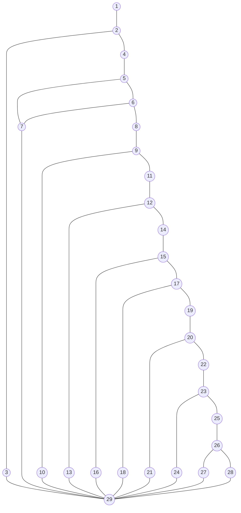

**Convención del grafo:** las aristas no llevan flecha ni etiqueta; el flujo va de arriba hacia abajo y converge en los nodos de unión y en el nodo final (29). De cada nodo predicado salen dos aristas: la de la **izquierda** corresponde a la condición verdadera (**sí**) y la de la **derecha** a la falsa (**no**).

(Para obtener la imagen: pegar el bloque en https://mermaid.live y exportar PNG/SVG.)

## 3. Complejidad ciclomática V(G)

| Método | Cálculo | Resultado |
|---|---|---|
| Nodos predicado | P = 10 (nodos 2, 5, 6, 9, 12, 15, 17, 20, 23, 26) → V(G) = P + 1 | **11** |
| Aristas y nodos | E = 38, N = 29 → V(G) = E − N + 2 = 38 − 29 + 2 | **11** |
| Regiones | 10 regiones cerradas + 1 exterior | **11** |

Hay **11 caminos independientes**.

## 4. Caminos independientes

| Camino | Recorrido | Descripción |
|---|---|---|
| C1 | 1 → 2(sí) → 3 → 29 | Superó el límite de envíos |
| C2 | … → 5(sí) → 7 → 29 | El reto no existe |
| C3 | … → 5(no) → 6(sí) → 7 → 29 | El reto existe pero está inactivo |
| C4 | … → 9(no) → 11 → 12(sí) → 13 → 29 | El reto no está asociado al evento |
| C5 | … → 6(no) → 8 → 9(sí) → 10 → 29 | El evento no existe |
| C6 | … → 15(sí) → 16 → 29 | El evento aún no inicia |
| C7 | … → 17(sí) → 18 → 29 | El evento ya finalizó |
| C8 | … → 20(sí) → 21 → 29 | El usuario no está inscrito (o está descalificado) |
| C9 | … → 23(sí) → 24 → 29 | El usuario ya resolvió ese reto |
| C10 | … → 26(sí) → 27 → 29 | Flag correcta |
| C11 | … → 26(no) → 28 → 29 | Flag incorrecta |

Todos los caminos son factibles.

### 4.1 Grafo de cada camino

En cada grafo se resalta en naranja el recorrido del camino (nodos y
aristas); el resto del grafo queda en gris como referencia. Cada nodo
(círculo) es una sentencia o grupo de sentencias, numerado según el código
de la sección 1; el nodo 29 es el nodo final. Se usa la misma convención de la
sección 2 (izquierda = sí, derecha = no); en el recorrido escrito bajo cada
grafo, `(sí)`/`(no)` indica la salida que toma cada nodo predicado.

**C1 — Superó el límite de envíos**

`1 → 2(sí) → 3 → 29`

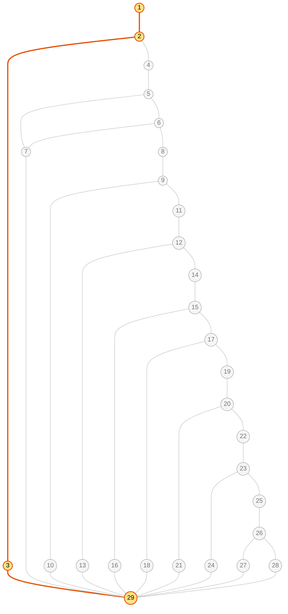

**C2 — El reto no existe**

`1 → 2(no) → 4 → 5(sí) → 7 → 29`

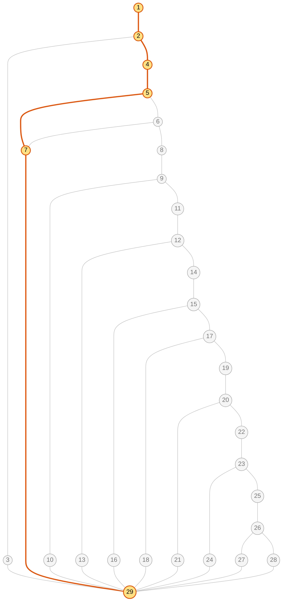

**C3 — El reto existe pero está inactivo**

`1 → 2(no) → 4 → 5(no) → 6(sí) → 7 → 29`

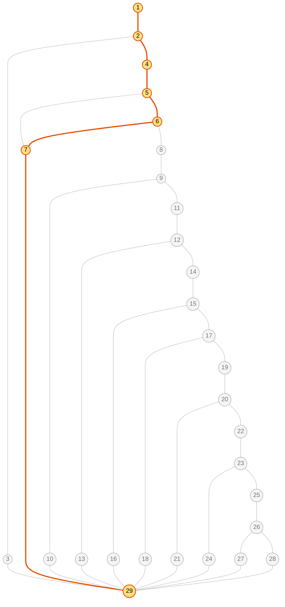

**C4 — El reto no está asociado al evento**

`1 → 2(no) → 4 → 5(no) → 6(no) → 8 → 9(no) → 11 → 12(sí) → 13 → 29`

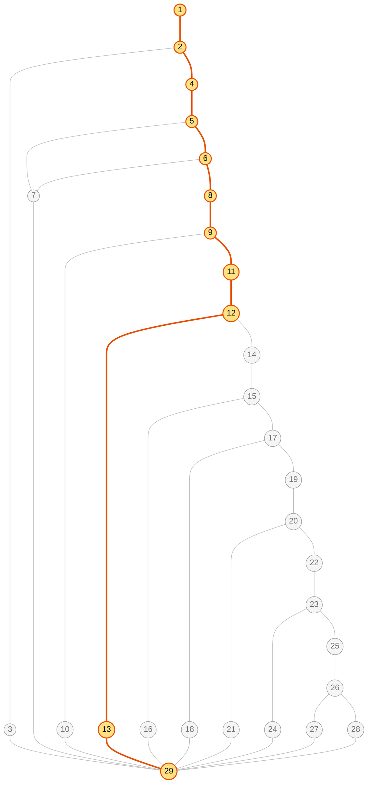

**C5 — El evento no existe**

`1 → 2(no) → 4 → 5(no) → 6(no) → 8 → 9(sí) → 10 → 29`

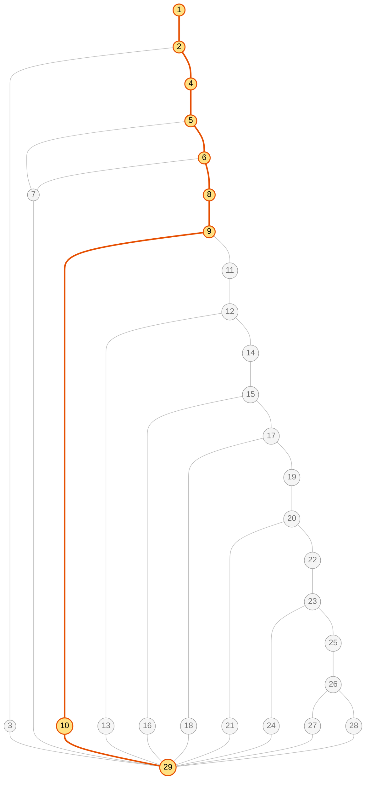

**C6 — El evento aún no inicia**

`1 → 2(no) → 4 → 5(no) → 6(no) → 8 → 9(no) → 11 → 12(no) → 14 → 15(sí) → 16 → 29`

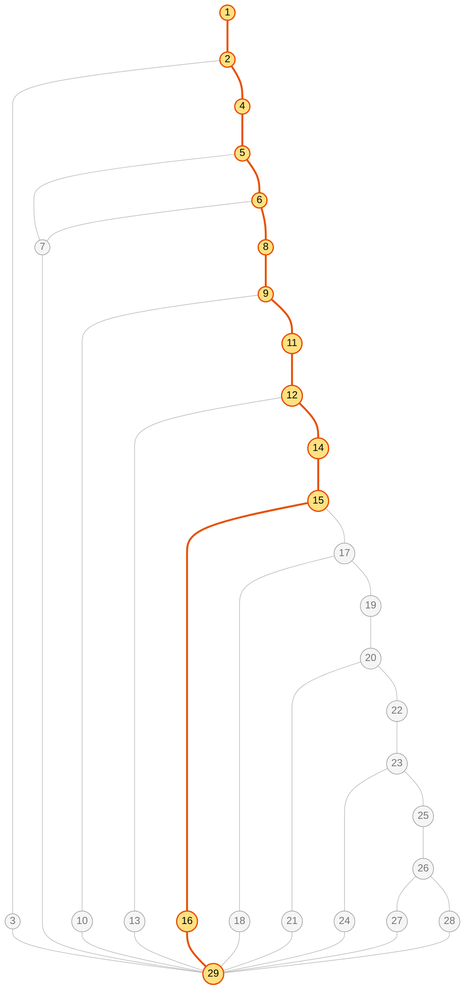

**C7 — El evento ya finalizó**

`1 → 2(no) → 4 → 5(no) → 6(no) → 8 → 9(no) → 11 → 12(no) → 14 → 15(no) → 17(sí) → 18 → 29`

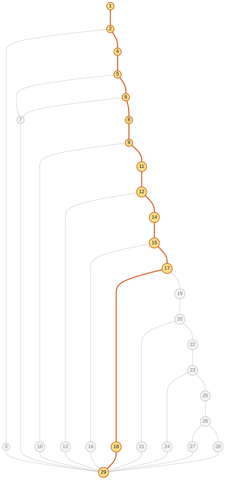

**C8 — El usuario no está inscrito (o está descalificado)**

`1 → 2(no) → 4 → 5(no) → 6(no) → 8 → 9(no) → 11 → 12(no) → 14 → 15(no) → 17(no) → 19 → 20(sí) → 21 → 29`

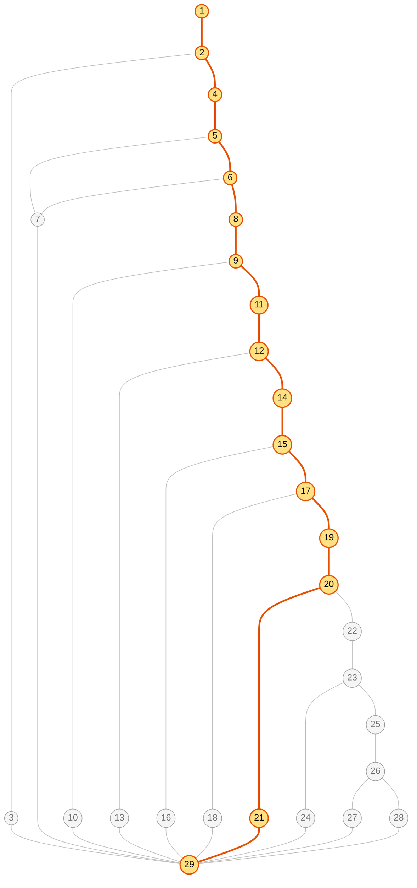

**C9 — El usuario ya resolvió ese reto**

`1 → 2(no) → 4 → 5(no) → 6(no) → 8 → 9(no) → 11 → 12(no) → 14 → 15(no) → 17(no) → 19 → 20(no) → 22 → 23(sí) → 24 → 29`

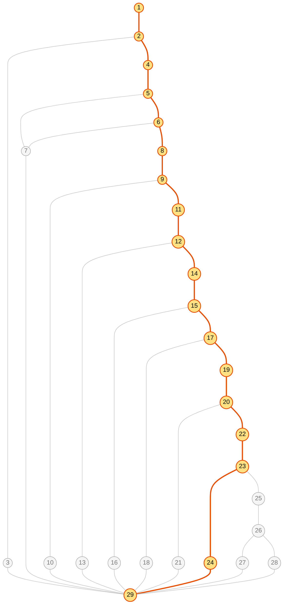

**C10 — Flag correcta**

`1 → 2(no) → 4 → 5(no) → 6(no) → 8 → 9(no) → 11 → 12(no) → 14 → 15(no) → 17(no) → 19 → 20(no) → 22 → 23(no) → 25 → 26(sí) → 27 → 29`

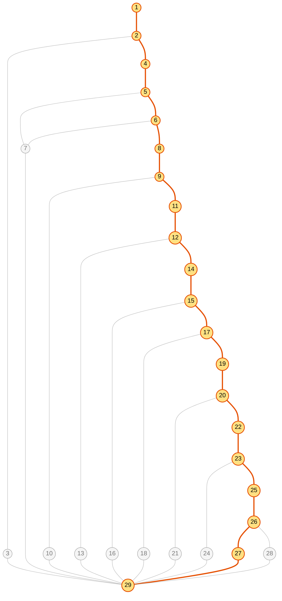

**C11 — Flag incorrecta**

`1 → 2(no) → 4 → 5(no) → 6(no) → 8 → 9(no) → 11 → 12(no) → 14 → 15(no) → 17(no) → 19 → 20(no) → 22 → 23(no) → 25 → 26(no) → 28 → 29`

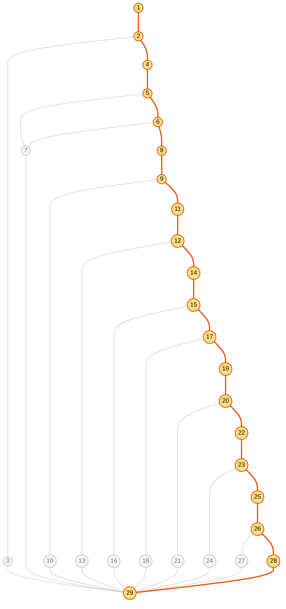

## 5. Casos de prueba

Escenario base (lo arma la fixture `escenario`): un evento cerrado **activo**
(inició ayer, termina mañana), un reto activo con flag `ITDB{flag_correcta}`
asociado al evento con 100 pts estáticos, y un estudiante **inscrito**.

| Caso | Test | Recorrido | Precondición (sobre el escenario base) | Entrada | Resultado esperado | Resultado obtenido |
|---|---|---|---|---|---|---|
| C1 | `test_C1_supera_rate_limit` | 1 → 2 → 3 → 29 | 15 envíos previos en el mismo minuto | 16º envío | `(False, "Demasiados intentos...")`; solo 15 filas en `Resuelve` | Aprobado |
| C2 | `test_C2_reto_inexistente` | 1 → 2 → 4 → 5 → 7 → 29 | — | `id_reto = 9999` | `(False, "Reto no disponible.")` | Aprobado |
| C3 | `test_C3_reto_inactivo` | 1 → 2 → 4 → 5 → 6 → 7 → 29 | Reto con `activo = False` asociado | flag correcta | `(False, "Reto no disponible.")` | Aprobado |
| C4 | `test_C4_reto_no_pertenece_al_evento` | 1 → 2 → 4 → 5 → 6 → 8 → 9 → 11 → 12 → 13 → 29 | Reto creado sin asociar al evento | flag correcta | `(False, "El reto no pertenece a este evento.")` | Aprobado |
| C5 | `test_C5_evento_inexistente` | 1 → 2 → 4 → 5 → 6 → 8 → 9 → 10 → 29 | — | `id_evento = 9999` | `(False, "Evento no disponible.")`; 0 filas en `Resuelve` | Aprobado |
| C6 | `test_C6_evento_futuro` | 1 → 2 → 4 → 5 → 6 → 8 → 9 → 11 → 12 → 14 → 15 → 16 → 29 | Evento que inicia mañana | flag correcta | `(False, "El evento aún no ha iniciado.")` | Aprobado |
| C7 | `test_C7_evento_concluido` | 1 → 2 → 4 → 5 → 6 → 8 → 9 → 11 → 12 → 14 → 15 → 17 → 18 → 29 | Evento que terminó ayer | flag correcta | `(False, "El evento ha finalizado.")` | Aprobado |
| C8a | `test_C8_usuario_no_inscrito[sin_inscripcion]` | 1 → 2 → 4 → 5 → 6 → 8 → 9 → 11 → 12 → 14 → 15 → 17 → 19 → 20 → 21 → 29 | Usuario sin fila en `Participa` | flag correcta | `(False, "No estás inscrito en este evento.")` | Aprobado |
| C8b | `test_C8_usuario_no_inscrito[descalificado]` | 1 → 2 → 4 → 5 → 6 → 8 → 9 → 11 → 12 → 14 → 15 → 17 → 19 → 20 → 21 → 29 | Usuario con estado `descalificado` | flag correcta | `(False, "No estás inscrito en este evento.")` | Aprobado |
| C9 | `test_C9_reto_ya_resuelto` | 1 → 2 → 4 → 5 → 6 → 8 → 9 → 11 → 12 → 14 → 15 → 17 → 19 → 20 → 22 → 23 → 24 → 29 | El usuario ya acertó el reto | flag correcta otra vez | `(False, "El reto ah sido resuelto.")`; sigue 1 fila | Aprobado |
| C10 | `test_C10_flag_correcta` | 1 → 2 → 4 → 5 → 6 → 8 → 9 → 11 → 12 → 14 → 15 → 17 → 19 → 20 → 22 → 23 → 25 → 26 → 27 → 29 | — | `ITDB{flag_correcta}` | `(True, "¡Flag correcta!")`; 1 fila con `flag_correcta = True` | Aprobado |
| C11 | `test_C11_flag_incorrecta` | 1 → 2 → 4 → 5 → 6 → 8 → 9 → 11 → 12 → 14 → 15 → 17 → 19 → 20 → 22 → 23 → 25 → 26 → 28 → 29 | — | `ITDB{mala}` | `(False, "Flag incorrecta.")`; 1 fila con `flag_correcta = False` | Aprobado |

## 6. Resultados y cobertura

Ejecución: `pytest tests/test_01_enviar_flag.py --cov=itdb_ctf.core.envio_logic --cov-branch --cov-report=term-missing`
(2026-11-07, Python 3.14.5, pytest 9.1.1, BD `ctf_itdb_test`).

**12 de 12 casos aprobados** (11 caminos; C8 se prueba con 2 entradas).

| Archivo | Sentencias | Sin cubrir | Ramas | Ramas parciales | Cobertura | Líneas sin cubrir |
|---|---|---|---|---|---|---|
| `itdb_ctf/core/envio_logic.py` | 44 | 0 | 18 | 0 | **100 %** | — |

| Función | Sentencias cubiertas | Ramas parciales | Cobertura |
|---|---|---|---|
| `enviar_flag` (líneas 10–61) | 35 / 35 | 0 | **100 %** |

Los 11 caminos independientes fueron ejecutados y el reporte de cobertura no
deja ninguna línea ni rama sin cubrir.

## 7. Resumen de caminos

Un caso por camino independiente (V(G) = 11). Escenario base: usuario 2 inscrito en el evento 1 (en curso); reto 1 activo, asociado al evento 1, con flag `ITDB{flag_correcta}`.

| Camino | Precondición | Entrada | Resultado esperado |
|---|---|---|---|
| C1 | Usuario 2 ya envió 15 veces `ITDB{mala}` al reto 1 en los últimos 60 s | `id_usuario = 2`, `id_reto = 1`, `id_evento = 1`, `flag_enviada = "ITDB{flag_correcta}"` | `(False, "Demasiados intentos. Esperá t s.")` |
| C2 | Escenario base; no existe el reto 9999 | `id_usuario = 2`, `id_reto = 9999`, `id_evento = 1`, `flag_enviada = "ITDB{flag_correcta}"` | `(False, "Reto no disponible.")` |
| C3 | Reto 2 con `activo = False`, asociado al evento 1 | `id_usuario = 2`, `id_reto = 2`, `id_evento = 1`, `flag_enviada = "ITDB{flag_correcta}"` | `(False, "Reto no disponible.")` |
| C4 | Reto 2 activo, sin fila en `Contiene` para el evento 1 | `id_usuario = 2`, `id_reto = 2`, `id_evento = 1`, `flag_enviada = "ITDB{flag_correcta}"` | `(False, "El reto no pertenece a este evento.")` |
| C5 | Escenario base; no existe el evento 9999 | `id_usuario = 2`, `id_reto = 1`, `id_evento = 9999`, `flag_enviada = "ITDB{flag_correcta}"` | `(False, "Evento no disponible.")` |
| C6 | Evento 2 con `fec_inicio` = mañana; reto 1 asociado y usuario 2 inscrito | `id_usuario = 2`, `id_reto = 1`, `id_evento = 2`, `flag_enviada = "ITDB{flag_correcta}"` | `(False, "El evento aún no ha iniciado.")` |
| C7 | Evento 2 con `fec_fin` = ayer; reto 1 asociado y usuario 2 inscrito | `id_usuario = 2`, `id_reto = 1`, `id_evento = 2`, `flag_enviada = "ITDB{flag_correcta}"` | `(False, "El evento ha finalizado.")` |
| C8 | Usuario 3 sin fila en `Participa` para el evento 1 | `id_usuario = 3`, `id_reto = 1`, `id_evento = 1`, `flag_enviada = "ITDB{flag_correcta}"` | `(False, "No estás inscrito en este evento.")` |
| C9 | Usuario 2 ya resolvió el reto 1 en el evento 1 | `id_usuario = 2`, `id_reto = 1`, `id_evento = 1`, `flag_enviada = "ITDB{flag_correcta}"` | `(False, "El reto ah sido resuelto.")` |
| C10 | Escenario base | `id_usuario = 2`, `id_reto = 1`, `id_evento = 1`, `flag_enviada = "ITDB{flag_correcta}"` | `(True, "¡Flag correcta!")` |
| C11 | Escenario base | `id_usuario = 2`, `id_reto = 1`, `id_evento = 1`, `flag_enviada = "ITDB{mala}"` | `(False, "Flag incorrecta.")` |

## 8. Recorrido de cada camino

Caminos independientes del conjunto base (V(G) = 11).

| Camino | Recorrido |
|---|---|
| C1 | 1 - 2 - 3 - 29 |
| C2 | 1 - 2 - 4 - 5 - 7 - 29 |
| C3 | 1 - 2 - 4 - 5 - 6 - 7 - 29 |
| C4 | 1 - 2 - 4 - 5 - 6 - 8 - 9 - 11 - 12 - 13 - 29 |
| C5 | 1 - 2 - 4 - 5 - 6 - 8 - 9 - 10 - 29 |
| C6 | 1 - 2 - 4 - 5 - 6 - 8 - 9 - 11 - 12 - 14 - 15 - 16 - 29 |
| C7 | 1 - 2 - 4 - 5 - 6 - 8 - 9 - 11 - 12 - 14 - 15 - 17 - 18 - 29 |
| C8 | 1 - 2 - 4 - 5 - 6 - 8 - 9 - 11 - 12 - 14 - 15 - 17 - 19 - 20 - 21 - 29 |
| C9 | 1 - 2 - 4 - 5 - 6 - 8 - 9 - 11 - 12 - 14 - 15 - 17 - 19 - 20 - 22 - 23 - 24 - 29 |
| C10 | 1 - 2 - 4 - 5 - 6 - 8 - 9 - 11 - 12 - 14 - 15 - 17 - 19 - 20 - 22 - 23 - 25 - 26 - 27 - 29 |
| C11 | 1 - 2 - 4 - 5 - 6 - 8 - 9 - 11 - 12 - 14 - 15 - 17 - 19 - 20 - 22 - 23 - 25 - 26 - 28 - 29 |

## 9. Código numerado por nodos

Renglones numerados de forma correlativa desde 1; el comentario indica el nodo del grafo de flujo que ocupa cada renglón (`# nodo # nodo` cuando hay más de uno). El último nodo `(fin)` no ocupa renglón: es la salida común de todos los `return`.

```python
1   def enviar_flag(id_usuario, id_reto, id_evento, flag_enviada):
2       ok, faltan = permitir_flag(id_usuario, id_reto)            # 1
3       if not ok:                                                 # 2
4           return False, "Demasiados intentos..."                 # 3
5       with Session(engine) as s:                                 # 4
6           reto = s.get(Reto, id_reto)                            # 4
7           if not reto or not reto.activo:                        # 5 # 6
8               return False, "Reto no disponible."                # 7
9           ev = s.get(Evento, id_evento)                          # 8
10          if not ev:                                             # 9
11              return False, "Evento no disponible."              # 10
12          cont = s.exec(select(Contiene)...).first()             # 11
13          if not cont:                                           # 12
14              return False, "El reto no pertenece a este evento."# 13
15          est_evento = estado_evento(ev)                         # 14
16          if est_evento == "futuro":                             # 15
17              return False, "El evento aún no ha iniciado."      # 16
18          if est_evento == "concluido":                          # 17
19              return False, "El evento ha finalizado."           # 18
20          inscrito = s.exec(select(Participa)...).first()        # 19
21          if not inscrito:                                       # 20
22              return False, "No estás inscrito en este evento."  # 21
23          resuelto = s.exec(select(Resuelve)...).first()         # 22
24          if resuelto:                                           # 23
25              return False, "El reto ah sido resuelto."          # 24
26          correcta = flag_hasher.verificar(...); s.add(Resuelve) # 25
27          if correcta:                                           # 26
28              refrescar_puntaje(...); commit; publicar; return True  # 27
29          s.commit(); return False, "Flag incorrecta."           # 28
                                                                   # 29 (fin)
```
