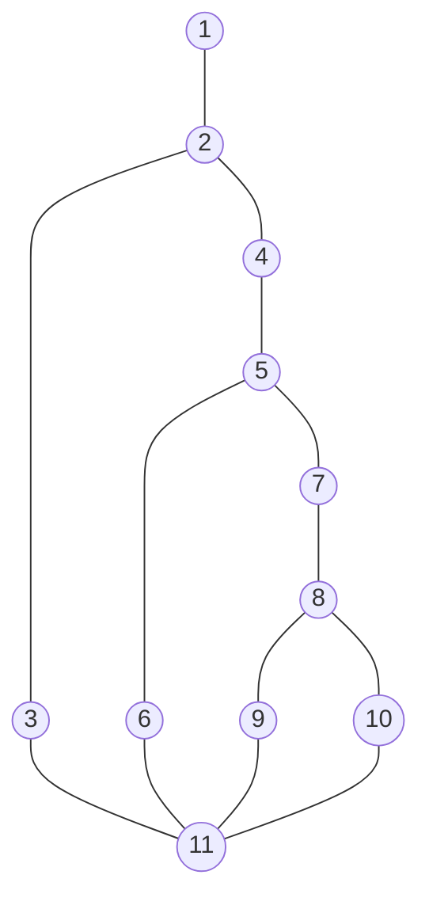
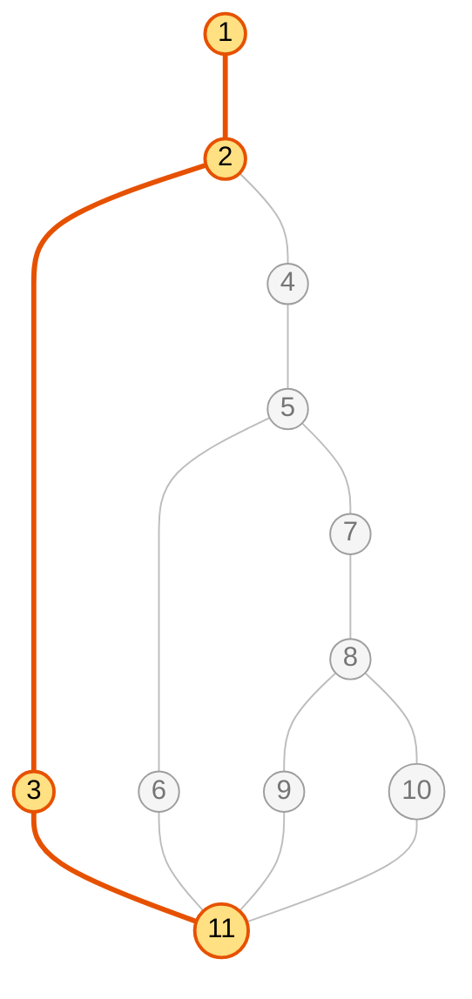
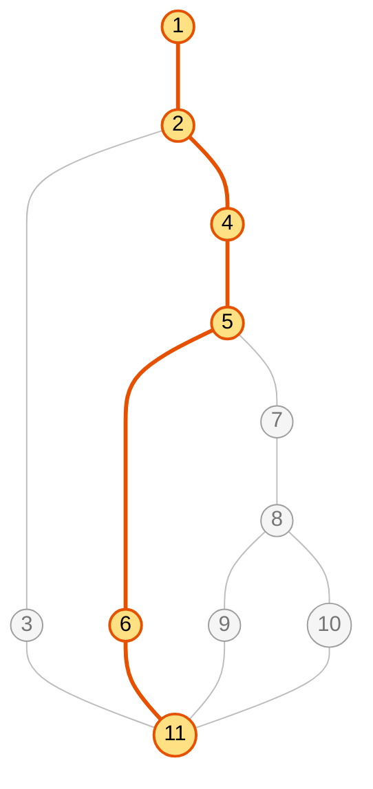
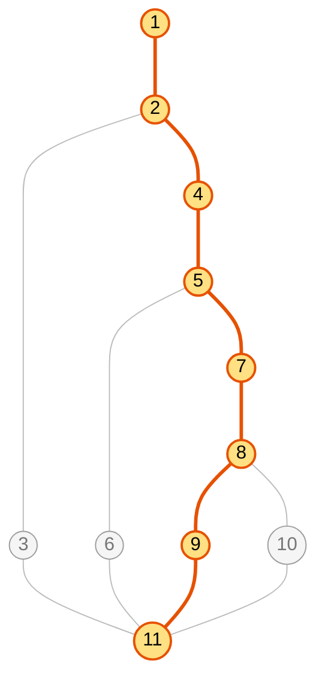
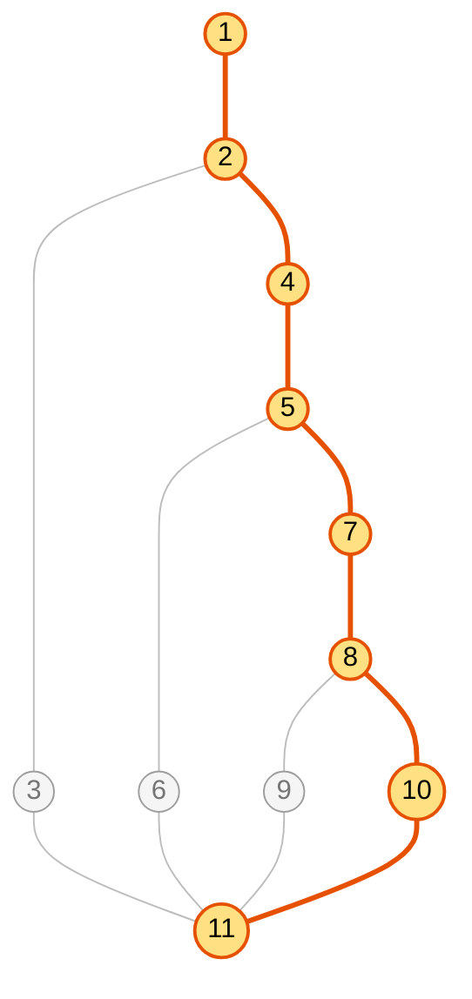

# Prueba de caja blanca 02 — `adquirir_pista`

- **Módulo:** `itdb_ctf/core/compra_logic.py`
- **Función:** `adquirir_pista(id_usuario, id_evento, id_reto, id_pista) -> (bool, str)`
- **Propósito:** comprar una pista descontando su costo del puntaje del estudiante.
- **Técnica:** camino básico (McCabe) + cobertura de ramas con `pytest-cov`.
- **Archivo de pruebas:** `tests/test_02_adquirir_pista.py`

---

## 1. Código fuente con nodos numerados

```python
 7  def adquirir_pista(id_usuario, id_evento, id_reto, id_pista):
 8      with Session(engine) as s:                                  # 1
 9          pista = s.get(Pista, id_pista)                          # 1
10          if not pista:                                           # 2
11              return False, "Pista inexistente"                   # 3
12-16       ad = s.exec(select(Compra)...).first()                  # 4
17          if ad:                                                  # 5
18              return False, "Pista adquirida"                     # 6
19          saldo = puntaje_total_usuario(s, id_usuario, id_evento) # 7
20          if pista.costo > saldo:                                 # 8
21              return False, "Puntos insuficientes..."             # 9
22-33       s.add(Compra(...)); s.commit(); publicar...; return True# 10
                                                                    # 11 (fin)
```

## 2. Grafo de flujo



**Convención del grafo:** las aristas no llevan flecha ni etiqueta; el flujo va de arriba hacia abajo y converge en los nodos de unión y en el nodo final (11). De cada nodo predicado salen dos aristas: la de la **izquierda** corresponde a la condición verdadera (**sí**) y la de la **derecha** a la falsa (**no**).

## 3. Complejidad ciclomática V(G)

| Método | Cálculo | Resultado |
|---|---|---|
| Nodos predicado | P = 3 (nodos 2, 5, 8) → V(G) = P + 1 | **4** |
| Aristas y nodos | E = 13, N = 11 → V(G) = 13 − 11 + 2 | **4** |
| Regiones | 3 cerradas + 1 exterior | **4** |

## 4. Caminos independientes

| Camino | Recorrido | Descripción |
|---|---|---|
| C1 | 1 → 2(sí) → 3 → 11 | La pista no existe |
| C2 | 1 → 2(no) → 4 → 5(sí) → 6 → 11 | El estudiante ya compró esa pista |
| C3 | … → 5(no) → 7 → 8(sí) → 9 → 11 | No le alcanzan los puntos |
| C4 | … → 8(no) → 10 → 11 | Compra exitosa |

Todos los caminos son factibles.

### 4.1 Grafo de cada camino

En cada grafo se resalta en naranja el recorrido del camino (nodos y
aristas); el resto del grafo queda en gris como referencia. Cada nodo
(círculo) es una sentencia o grupo de sentencias, numerado según el código
de la sección 1; el nodo 11 es el nodo final. Se usa la misma convención de la
sección 2 (izquierda = sí, derecha = no); en el recorrido escrito bajo cada
grafo, `(sí)`/`(no)` indica la salida que toma cada nodo predicado.

**C1 — La pista no existe**

`1 → 2(sí) → 3 → 11`



**C2 — El estudiante ya compró esa pista**

`1 → 2(no) → 4 → 5(sí) → 6 → 11`



**C3 — No le alcanzan los puntos**

`1 → 2(no) → 4 → 5(no) → 7 → 8(sí) → 9 → 11`



**C4 — Compra exitosa**

`1 → 2(no) → 4 → 5(no) → 7 → 8(no) → 10 → 11`



## 5. Casos de prueba

Escenario base (fixture `escenario`): evento activo; el estudiante resolvió un
reto de 100 pts, así que su **saldo es 100**. Hay un segundo reto donde se crean
las pistas.

C4 se prueba dos veces aplicando **valor límite**: costo menor al saldo y costo
exactamente igual al saldo (la condición es `costo > saldo`, así que con costo =
saldo la compra debe permitirse). C3 usa el valor límite del otro lado
(costo = saldo + 1).

| Caso | Test | Recorrido | Precondición | Entrada | Resultado esperado | Resultado obtenido |
|---|---|---|---|---|---|---|
| C1 | `test_C1_pista_inexistente` | 1 → 2 → 3 → 11 | — | `id_pista = 9999` | `(False, "Pista inexistente")`; 0 compras | Aprobado |
| C2 | `test_C2_pista_ya_adquirida` | 1 → 2 → 4 → 5 → 6 → 11 | Pista de 10 ya comprada | misma pista | `(False, "Pista adquirida")`; sigue 1 compra | Aprobado |
| C3 | `test_C3_puntos_insuficientes` | 1 → 2 → 4 → 5 → 7 → 8 → 9 → 11 | Pista de costo 101 | esa pista | `(False, "Puntos insuficientes...")`; 0 compras | Aprobado |
| C4a | `test_C4_compra_exitosa[costo_menor_al_saldo]` | 1 → 2 → 4 → 5 → 7 → 8 → 10 → 11 | Pista de costo 30 | esa pista | `(True, "Pista adquirida.")`; 1 compra de 30 | Aprobado |
| C4b | `test_C4_compra_exitosa[costo_igual_al_saldo]` | 1 → 2 → 4 → 5 → 7 → 8 → 10 → 11 | Pista de costo 100 | esa pista | `(True, "Pista adquirida.")`; 1 compra de 100 | Aprobado |

## 6. Resultados y cobertura

Ejecución: `pytest tests/test_02_adquirir_pista.py --cov=itdb_ctf.core.compra_logic --cov-branch --cov-report=term-missing`
(2026-10-02, Python 3.14.5, pytest 9.1.1, BD `ctf_itdb_test`).

**5 de 5 casos aprobados.**

| Función | Sentencias cubiertas | Ramas parciales | Cobertura |
|---|---|---|---|
| `adquirir_pista` | 16 / 16 | 0 | **100 %** |

## 7. Resumen de caminos

Un caso por camino independiente (V(G) = 4). Escenario base: usuario 2 inscrito en el evento 1 con saldo 100 (resolvió el reto 1, de 100 pts); reto 2 asociado al evento 1.

| Camino | Precondición | Entrada | Resultado esperado |
|---|---|---|---|
| C1 | Escenario base; no existe la pista 9999 | `id_usuario = 2`, `id_evento = 1`, `id_reto = 2`, `id_pista = 9999` | `(False, "Pista inexistente")` |
| C2 | Pista 1 del reto 2 (costo 10) ya comprada por el usuario 2 | `id_usuario = 2`, `id_evento = 1`, `id_reto = 2`, `id_pista = 1` | `(False, "Pista adquirida")` |
| C3 | Pista 1 del reto 2 con costo 101 (saldo 100) | `id_usuario = 2`, `id_evento = 1`, `id_reto = 2`, `id_pista = 1` | `(False, "Puntos insuficientes para adquirir la pista")` |
| C4 | Pista 1 del reto 2 con costo 30 (saldo 100) | `id_usuario = 2`, `id_evento = 1`, `id_reto = 2`, `id_pista = 1` | `(True, "Pista adquirida.")` |

## 8. Recorrido de cada camino

Caminos independientes del conjunto base (V(G) = 4).

| Camino | Recorrido |
|---|---|
| C1 | 1 - 2 - 3 - 11 |
| C2 | 1 - 2 - 4 - 5 - 6 - 11 |
| C3 | 1 - 2 - 4 - 5 - 7 - 8 - 9 - 11 |
| C4 | 1 - 2 - 4 - 5 - 7 - 8 - 10 - 11 |

## 9. Código numerado por nodos

Renglones numerados de forma correlativa desde 1; el comentario indica el nodo del grafo de flujo que ocupa cada renglón (`# nodo # nodo` cuando hay más de uno). El último nodo `(fin)` no ocupa renglón: es la salida común de todos los `return`.

```python
1   def adquirir_pista(id_usuario, id_evento, id_reto, id_pista):
2       with Session(engine) as s:                                  # 1
3           pista = s.get(Pista, id_pista)                          # 1
4           if not pista:                                           # 2
5               return False, "Pista inexistente"                   # 3
6           ad = s.exec(select(Compra)...).first()                  # 4
7           if ad:                                                  # 5
8               return False, "Pista adquirida"                     # 6
9           saldo = puntaje_total_usuario(s, id_usuario, id_evento) # 7
10          if pista.costo > saldo:                                 # 8
11              return False, "Puntos insuficientes..."             # 9
12          s.add(Compra(...)); s.commit(); publicar...; return True# 10
                                                                    # 11 (fin)
```
