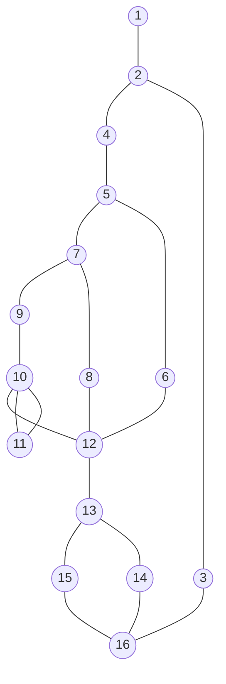
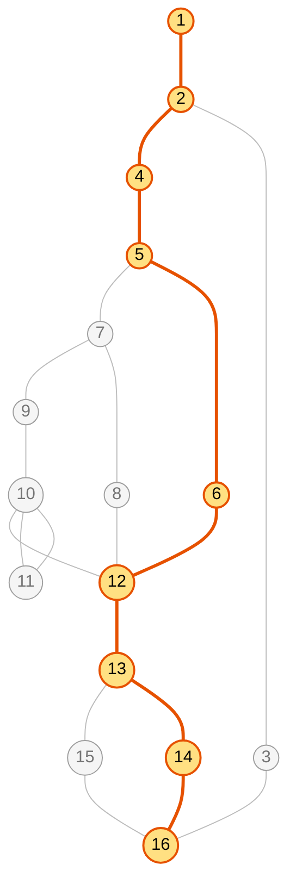
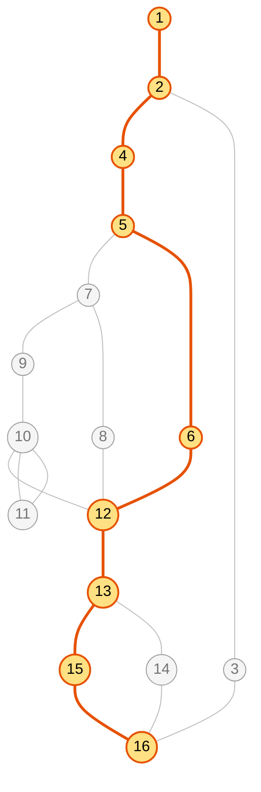
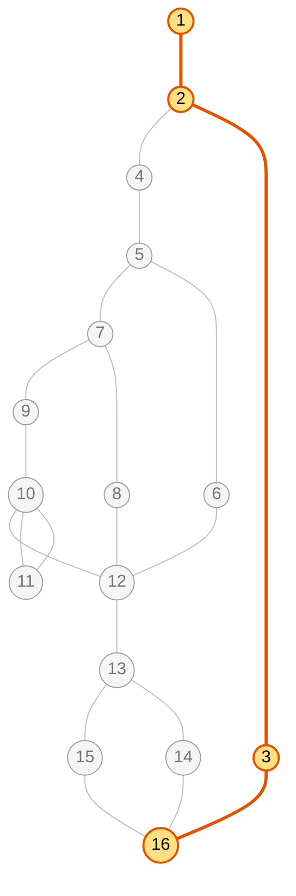
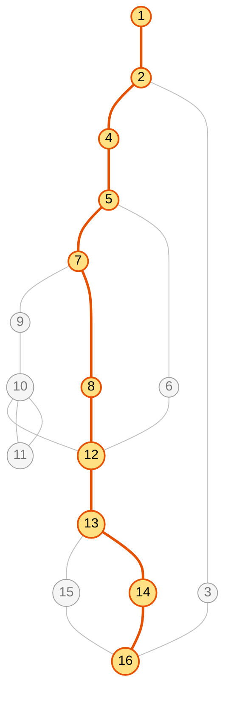
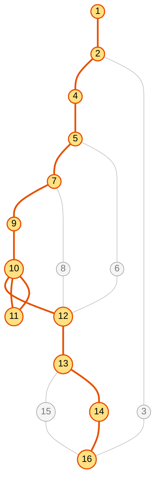
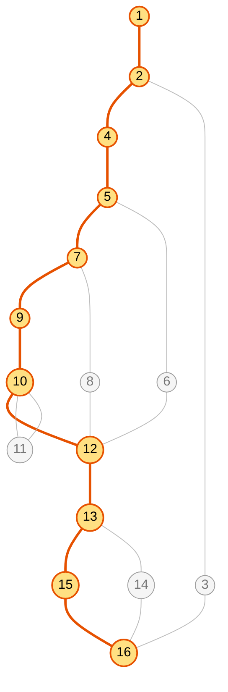

# Prueba de caja blanca 03 — `puntaje_total_usuario`

- **Módulo:** `itdb_ctf/core/puntaje_logic.py`
- **Función:** `puntaje_total_usuario(session, id_usuario, id_evento, corte=None) -> int`
- **Propósito:** calcular el puntaje de un estudiante en un evento: suma de los
  retos resueltos menos los puntos gastados en pistas, nunca menor a 0.
  `corte` es el instante del **freeze** del scoreboard: si viene, solo cuenta lo
  ocurrido hasta ese momento.
- **Técnica:** camino básico (McCabe) + cobertura de ramas con `pytest-cov`.
- **Archivo de pruebas:** `tests/test_03_puntaje_total_usuario.py`

---

## 1. Código fuente con nodos numerados

```python
54   def _hasta_corte(q, columna, corte: datetime | None):
55       # `corte` (freeze): limita la consulta a lo ocurrido hasta ese instante.
56       return q if corte is None else q.where(columna <= corte)                                                        # (ver nota)

58   def puntaje_total_usuario(session:Session, id_usuario:int, id_evento:int,
59                             corte: datetime | None = None) -> int:
60       # `corte` (freeze): solo cuenta aciertos/compras con fecha <= corte y, en
61       #   eventos dinámicos, recalcula el puntaje de cada reto a ese instante.
62       ev = session.get(Evento, id_evento)                                                                             # 1
63       if not ev:                                                                                                      # 2
64           return 0                                                                                                    # 3
65       gastados = session.exec(_hasta_corte(                                                                           # 4
66           select(func.coalesce(func.sum(Compra.puntos_usados), 0)).where(                                             # 4
67               Compra.id_usuario == id_usuario,                                                                        # 4
68               Compra.id_evento == id_evento,                                                                          # 4
69           ),                                                                                                          # 4
70           Compra.fec_compra, corte)).one()                                                                            # 4
71
72       mod_ev = session.get(ModoPuntaje, ev.id_modo_puntaje)                                                           # 4
73       if mod_ev.etiqueta == "estatico":                                                                               # 5
74           q = (select(func.coalesce(func.sum(Contiene.puntaje_inicial), 0))                                           # 6
75                .join(Resuelve, (Contiene.id_reto == Resuelve.id_reto) & (Contiene.id_evento == Resuelve.id_evento))   # 6
76                .where(                                                                                                # 6
77                    Resuelve.id_usuario == id_usuario,                                                                 # 6
78                    Resuelve.id_evento == id_evento,                                                                   # 6
79                    Resuelve.flag_correcta == True))  # noqa: E712                                                     # 6
80           total = session.exec(_hasta_corte(q, Resuelve.fec_envio, corte)).one()                                      # 6
81       elif corte is None:                                                                                             # 7
82           # dinámico en vivo: usa el puntaje_actual ya recalculado
83           total = session.exec(                                                                                       # 8
84               select(func.coalesce(func.sum(Contiene.puntaje_actual), 0))                                             # 8
85               .join(Resuelve, (Contiene.id_reto == Resuelve.id_reto) & (Contiene.id_evento == Resuelve.id_evento))    # 8
86               .where(                                                                                                 # 8
87                   Resuelve.id_usuario == id_usuario,                                                                  # 8
88                   Resuelve.id_evento == id_evento,                                                                    # 8
89                   Resuelve.flag_correcta == True)).one()  # noqa: E712                                                # 8
90       else:
91           # dinámico congelado: recalcula el valor de cada reto resuelto a `corte`
92           retos = session.exec(                                                                                       # 9
93               select(Resuelve.id_reto).where(                                                                         # 9
94                   Resuelve.id_usuario == id_usuario,                                                                  # 9
95                   Resuelve.id_evento == id_evento,                                                                    # 9
96                   Resuelve.flag_correcta == True,  # noqa: E712                                                       # 9
97                   Resuelve.fec_envio <= corte,                                                                        # 9
98               )                                                                                                       # 9
99           ).all()                                                                                                     # 9
100          total = sum(calcular_puntaje(session, id_reto, id_evento, corte) for id_reto in retos)                      # 10 # 11
101
102      score = total - gastados                                                                                        # 12
103      return score if score > 0 else 0                                                                                # 13 # 14 # 15
                                                                                                                         # 16 (fin)
```

Notas de modelado:
- El generador de la línea 100 es un **bucle**, y McCabe cuenta cada bucle como un
  nodo predicado (10: ¿queda otro reto por sumar?).
- `_hasta_corte` es una función auxiliar con su propio grafo (un solo predicado,
  `corte is None`, V(G) = 2). Dentro de `puntaje_total_usuario` cada llamada es
  una sentencia más de 4 o 6. Sus dos caminos se cubren con el par de pruebas C1:
  `test_C1_estatico_en_vivo` (sin corte → devuelve la consulta tal cual) y
  `test_C1_estatico_congelado` (con corte → agrega el filtro de fecha).

**Ajuste del código (Watson y McCabe, 1996, §5.1).** La versión anterior tenía
V(G) = 9 y dos caminos que ninguna entrada podía recorrer:
- `mod_ev is None` con un evento existente era imposible por la clave foránea
  `evento.id_modo_puntaje → modo_puntaje`.
- `corte` se preguntaba tres veces (filtro de compras, filtro de la rama estática
  y `elif` de la rama dinámica); las combinaciones contradictorias ("no hay corte"
  en un punto y "sí hay corte" en otro) formaban caminos imposibles.

Se reestructuró la función para quitar esas dependencias: si el evento no existe
se devuelve 0 de inmediato, se eliminó la condición `mod_ev is None` y los
filtros por `corte` se movieron a `_hasta_corte`. La firma y el resultado de la
función no cambian; ahora todos los caminos son factibles.

## 2. Grafo de flujo



**Convención del grafo:** las aristas no llevan flecha ni etiqueta; el flujo va de arriba hacia abajo y converge en los nodos de unión y en el nodo final (16). De cada nodo predicado salen dos aristas: la de la **derecha** corresponde a la condición **verdadera** y la de la **izquierda** a la **falsa**.

## 3. Complejidad ciclomática V(G)

| Método | Cálculo | Resultado |
|---|---|---|
| Nodos predicado | P = 5 (nodos 2, 5, 7, 10, 13) → V(G) = P + 1 | **6** |
| Aristas y nodos | E = 20, N = 16 → V(G) = 20 − 16 + 2 | **6** |
| Regiones | 5 cerradas + 1 exterior | **6** |

## 4. Caminos independientes

| Camino | Recorrido | Descripción |
|---|---|---|
| C1 | 1 → 2(falso) → 4 → 5(verdadero) → 6 → 12 → 13(verdadero) → 14 → 16 | Estático, saldo positivo (en vivo y congelado) |
| C2 | … → 5(verdadero) → 6 → 12 → 13(falso) → 15 → 16 | Estático, gastó más de lo que ganó → piso 0 |
| C3 | 1 → 2(verdadero) → 3 → 16 | Evento inexistente → 0 |
| C4 | … → 5(falso) → 7(verdadero) → 8 → 12 → 13(verdadero) → 14 → 16 | Dinámico, en vivo |
| C5 | … → 7(falso) → 9 → 10(verdadero) → 11 → 10(falso) → 12 → 13(verdadero) → 14 → 16 | Dinámico congelado con retos resueltos (el bucle itera) |
| C6 | … → 7(falso) → 9 → 10(falso) → 12 → 13(falso) → 15 → 16 | Dinámico congelado sin retos antes del corte (0 vueltas) |

Todos los caminos son factibles: **6 caminos, uno o más tests por camino**.

### 4.1 Grafo de cada camino

En cada grafo se resalta en naranja el recorrido del camino (nodos y
aristas); el resto del grafo queda en gris como referencia. Cada nodo
(círculo) es una sentencia o grupo de sentencias, numerado según el código
de la sección 1; el nodo 16 es el nodo final. Se usa la misma convención de la
sección 2 (derecha = verdadero, izquierda = falso); en el recorrido escrito bajo cada
grafo, `(verdadero)`/`(falso)` indica la salida que toma cada nodo predicado.

**C1 — Estático, saldo positivo (en vivo y congelado)**

`1 → 2(falso) → 4 → 5(verdadero) → 6 → 12 → 13(verdadero) → 14 → 16`



**C2 — Estático, gastó más de lo que ganó → piso 0**

`1 → 2(falso) → 4 → 5(verdadero) → 6 → 12 → 13(falso) → 15 → 16`



**C3 — Evento inexistente → 0**

`1 → 2(verdadero) → 3 → 16`



**C4 — Dinámico, en vivo**

`1 → 2(falso) → 4 → 5(falso) → 7(verdadero) → 8 → 12 → 13(verdadero) → 14 → 16`



**C5 — Dinámico congelado con retos resueltos (el bucle itera)**

`1 → 2(falso) → 4 → 5(falso) → 7(falso) → 9 → 10(verdadero) → 11 → 10(falso) → 12 → 13(verdadero) → 14 → 16`



**C6 — Dinámico congelado sin retos antes del corte (0 vueltas)**

`1 → 2(falso) → 4 → 5(falso) → 7(falso) → 9 → 10(falso) → 12 → 13(falso) → 15 → 16`



## 5. Casos de prueba

Base común: evento activo (estático o dinámico según el caso) con un estudiante
inscrito. Para el freeze se usa `corte = ahora − 1 hora`, y los envíos y compras
se insertan con fechas antes o después de ese corte.

**Casos con letra.** El criterio de McCabe exige probar V(G) caminos, no V(G) tests: *"no set of 4 paths will suffice for testing, even if […] there are 39 distinct tests that concentrate on the 4 paths"* (Watson y McCabe, 1996, §5.1, p. 31). Los casos con letra (a, b, c) **no son caminos nuevos**: recorren el mismo camino con otros datos de entrada, como recomienda la misma fuente: *"develop and execute several input data sets for each of the paths in the basis"* (§5.7). Por eso `pytest` cuenta más tests que caminos.

| Caso | Test | Recorrido | Precondición | Entrada | Esperado | Obtenido |
|---|---|---|---|---|---|---|
| C1a | `test_C1_estatico_en_vivo` | 1 → 2 → 4 → 5 → 6 → 12 → 13 → 14 → 16 | Reto de 100 resuelto (+1 intento fallido), pista de 30 comprada | sin corte | `70` (100 − 30; el fallido no suma) | Aprobado |
| C1b | `test_C1_estatico_congelado` | 1 → 2 → 4 → 5 → 6 → 12 → 13 → 14 → 16 | Reto A resuelto antes del corte; reto B y compra de 30 después | con corte | `100` (y `170` sin corte) | Aprobado |
| C2 | `test_C2_piso_cero` | 1 → 2 → 4 → 5 → 6 → 12 → 13 → 15 → 16 | Reto de 100 resuelto, compra de 150 | sin corte | `0` (no −50) | Aprobado |
| C3 | `test_C3_evento_inexistente` | 1 → 2 → 3 → 16 | — | `id_evento = 9999` | `0` | Aprobado |
| C4 | `test_C4_dinamico_en_vivo` | 1 → 2 → 4 → 5 → 7 → 8 → 12 → 13 → 14 → 16 | Reto dinámico 500/100 con `puntaje_actual = 480`, resuelto | sin corte | `480` | Aprobado |
| C5 | `test_C5_dinamico_congelado_recalcula_decay` | 1 → 2 → 4 → 5 → 7 → 9 → 10 → 11 → 10 → 12 → 13 → 14 → 16 | Reto dinámico 500/100; 2 resoluciones antes del corte y 1 después | con corte | `499` = `formula_dinamic(500, 100, 1)` | Aprobado |
| C6 | `test_C6_dinamico_congelado_sin_resoluciones` | 1 → 2 → 4 → 5 → 7 → 9 → 10 → 12 → 13 → 15 → 16 | Solo resolvió después del corte | con corte | `0` | Aprobado |

## 6. Resultados y cobertura

Ejecución: `pytest tests/test_03_puntaje_total_usuario.py --cov=itdb_ctf.core.puntaje_logic --cov-branch --cov-report=term-missing`
(2026-11-07, Python 3.14.5, pytest 9.1.1, BD `ctf_itdb_test`).

**7 de 7 casos aprobados** para **6 caminos** (V(G) = 6): un caso por camino más 1 entrada adicional (C1b) que recorre un camino ya probado.

| Función | Sentencias cubiertas | Ramas parciales | Cobertura |
|---|---|---|---|
| `puntaje_total_usuario` (líneas 58–103) | 14 / 14 | 0 | **100 %** |
| `_hasta_corte` (líneas 54–56) | 1 / 1 | 0 | **100 %** |

`pytest-cov` mide ramas entre líneas y no las dos salidas del operador ternario de
la línea 56; que ambas se ejecutan lo demuestran los casos C1a (sin corte) y C1b
(con corte), cuyos resultados (`70` y `100`) solo son posibles si el filtro de
fecha se aplica únicamente cuando hay corte.

El reporte de `pytest-cov` muestra el archivo completo al 85 %: las líneas sin
cubrir (21, 28, 47, 50-51) pertenecen a `calcular_puntaje` y `refrescar_puntaje`,
que no forman parte de esta prueba.

## 7. Resumen de caminos

Un caso por camino independiente (V(G) = 6). Escenario base: usuario 2 inscrito en el evento 1 (en curso).

| Camino | Precondición | Entrada | Resultado esperado |
|---|---|---|---|
| C1 | Evento 1 estático; reto 1 (100 pts) resuelto, con 1 intento fallido; pista de 30 comprada | `id_usuario = 2`, `id_evento = 1`, `corte = None` | `70` |
| C2 | Evento 1 estático; reto 1 (100 pts) resuelto; pista de 150 comprada | `id_usuario = 2`, `id_evento = 1`, `corte = None` | `0` |
| C3 | Escenario base; no existe el evento 9999 | `id_usuario = 2`, `id_evento = 9999`, `corte = None` | `0` |
| C4 | Evento 1 dinámico; reto 1 (500/100, `puntaje_actual = 480`) resuelto | `id_usuario = 2`, `id_evento = 1`, `corte = None` | `480` |
| C5 | Evento 1 dinámico; reto 1 (500/100) resuelto por el usuario 2 y por otro usuario antes del corte, y por un tercero después | `id_usuario = 2`, `id_evento = 1`, `corte = ahora − 1 h` | `499` |
| C6 | Evento 1 dinámico; reto 1 (500/100) resuelto por el usuario 2 solo después del corte | `id_usuario = 2`, `id_evento = 1`, `corte = ahora − 1 h` | `0` |

## 8. Recorrido de cada camino

Caminos independientes del conjunto base (V(G) = 6).

| Camino | Recorrido |
|---|---|
| C1 | 1 - 2 - 4 - 5 - 6 - 12 - 13 - 14 - 16 |
| C2 | 1 - 2 - 4 - 5 - 6 - 12 - 13 - 15 - 16 |
| C3 | 1 - 2 - 3 - 16 |
| C4 | 1 - 2 - 4 - 5 - 7 - 8 - 12 - 13 - 14 - 16 |
| C5 | 1 - 2 - 4 - 5 - 7 - 9 - 10 - 11 - 10 - 12 - 13 - 14 - 16 |
| C6 | 1 - 2 - 4 - 5 - 7 - 9 - 10 - 12 - 13 - 15 - 16 |

## 9. Código numerado por nodos

Código completo de la función, renglón por renglón tal como está en el archivo (sin abreviar ni unir renglones), numerado de forma correlativa desde 1. El comentario de la derecha indica el nodo del grafo de flujo al que pertenece cada renglón (`# nodo # nodo` cuando un mismo renglón contiene más de un nodo); una sentencia que ocupa varios renglones pertenece toda al mismo nodo, y una condición compuesta (`or` / `and`) es un solo nodo. Los renglones sin nodo (la firma `def`, comentarios, docstring, líneas en blanco y `else:`) no son sentencias ejecutables. El último nodo `(fin)` no ocupa renglón: es la salida común de todos los `return`.

```python
1    def puntaje_total_usuario(session:Session, id_usuario:int, id_evento:int,
2                              corte: datetime | None = None) -> int:
3        # `corte` (freeze): solo cuenta aciertos/compras con fecha <= corte y, en
4        #   eventos dinámicos, recalcula el puntaje de cada reto a ese instante.
5        ev = session.get(Evento, id_evento)                                                                             # 1
6        if not ev:                                                                                                      # 2
7            return 0                                                                                                    # 3
8        gastados = session.exec(_hasta_corte(                                                                           # 4
9            select(func.coalesce(func.sum(Compra.puntos_usados), 0)).where(                                             # 4
10               Compra.id_usuario == id_usuario,                                                                        # 4
11               Compra.id_evento == id_evento,                                                                          # 4
12           ),                                                                                                          # 4
13           Compra.fec_compra, corte)).one()                                                                            # 4
14
15       mod_ev = session.get(ModoPuntaje, ev.id_modo_puntaje)                                                           # 4
16       if mod_ev.etiqueta == "estatico":                                                                               # 5
17           q = (select(func.coalesce(func.sum(Contiene.puntaje_inicial), 0))                                           # 6
18                .join(Resuelve, (Contiene.id_reto == Resuelve.id_reto) & (Contiene.id_evento == Resuelve.id_evento))   # 6
19                .where(                                                                                                # 6
20                    Resuelve.id_usuario == id_usuario,                                                                 # 6
21                    Resuelve.id_evento == id_evento,                                                                   # 6
22                    Resuelve.flag_correcta == True))  # noqa: E712                                                     # 6
23           total = session.exec(_hasta_corte(q, Resuelve.fec_envio, corte)).one()                                      # 6
24       elif corte is None:                                                                                             # 7
25           # dinámico en vivo: usa el puntaje_actual ya recalculado
26           total = session.exec(                                                                                       # 8
27               select(func.coalesce(func.sum(Contiene.puntaje_actual), 0))                                             # 8
28               .join(Resuelve, (Contiene.id_reto == Resuelve.id_reto) & (Contiene.id_evento == Resuelve.id_evento))    # 8
29               .where(                                                                                                 # 8
30                   Resuelve.id_usuario == id_usuario,                                                                  # 8
31                   Resuelve.id_evento == id_evento,                                                                    # 8
32                   Resuelve.flag_correcta == True)).one()  # noqa: E712                                                # 8
33       else:
34           # dinámico congelado: recalcula el valor de cada reto resuelto a `corte`
35           retos = session.exec(                                                                                       # 9
36               select(Resuelve.id_reto).where(                                                                         # 9
37                   Resuelve.id_usuario == id_usuario,                                                                  # 9
38                   Resuelve.id_evento == id_evento,                                                                    # 9
39                   Resuelve.flag_correcta == True,  # noqa: E712                                                       # 9
40                   Resuelve.fec_envio <= corte,                                                                        # 9
41               )                                                                                                       # 9
42           ).all()                                                                                                     # 9
43           total = sum(calcular_puntaje(session, id_reto, id_evento, corte) for id_reto in retos)                      # 10 # 11
44
45       score = total - gastados                                                                                        # 12
46       return score if score > 0 else 0                                                                                # 13 # 14 # 15
                                                                                                                         # 16 (fin)
```

El renglón 33 (`else:`) no tiene nodo: es la salida «no» del nodo 7.
