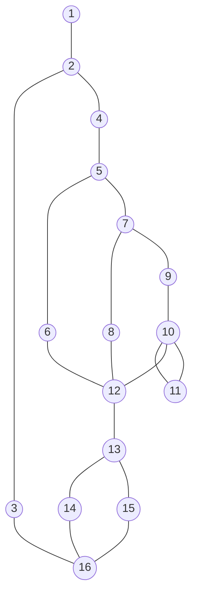
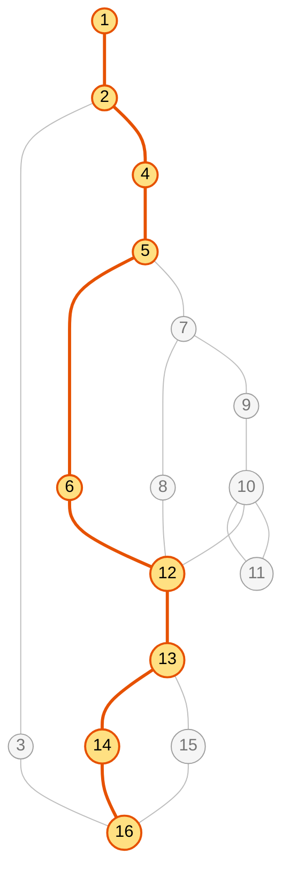
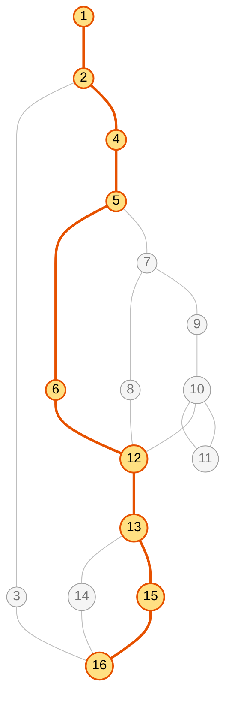
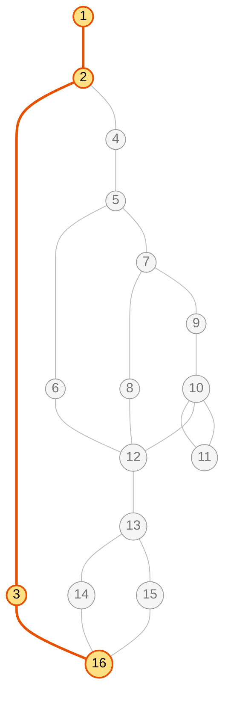
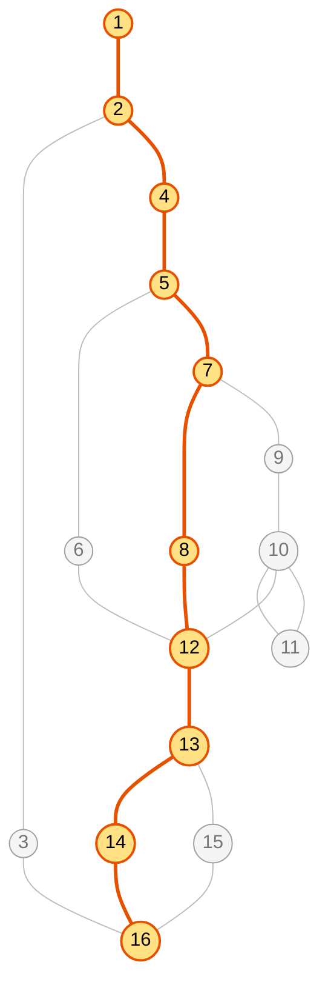
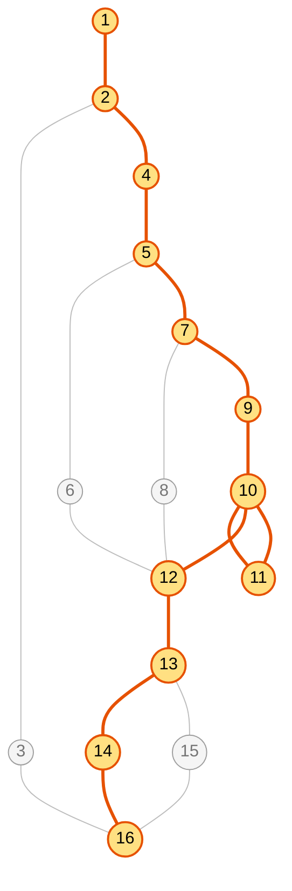
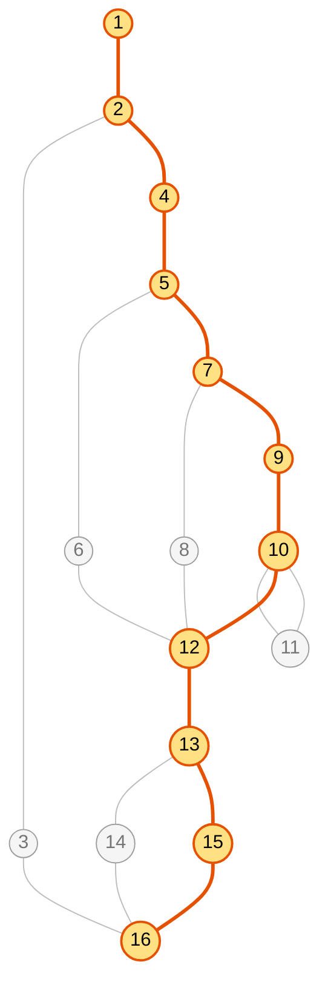

# Prueba de caja blanca 03 — `puntaje_total_usuario`

- **Módulo:** `itdb_ctf/core/puntaje_logic.py`
- **Función:** `puntaje_total_usuario(session, id_usuario, id_evento, corte=None) -> int`
- **Propósito:** calcular el puntaje de un estudiante en un evento: suma de los
  retos resueltos menos los puntos gastados en pistas, nunca menor a 0.
  `corte` es el instante del **freeze** del scoreboard: si viene, solo cuenta lo
  ocurrido hasta ese momento.
- **Técnica:** camino básico (McCabe) + cobertura de ramas con `pytest-cov`.
- **Archivo de pruebas:** `tests/test_03_puntaje_total_usuario.py`

---

## 1. Código fuente con nodos numerados

```python
 54  def _hasta_corte(q, columna, corte):
 56      return q if corte is None else q.where(columna <= corte)   # (ver nota)

 58  def puntaje_total_usuario(session, id_usuario, id_evento, corte=None):
 62      ev = session.get(Evento, id_evento)                        # 1
 63      if not ev:                                                 # 2
 64          return 0                                               # 3
 65-70   gastados = exec(_hasta_corte(sum(Compra...), fec_compra, corte))  # 4
 72      mod_ev = session.get(ModoPuntaje, ev.id_modo_puntaje)      # 4
 73      if mod_ev.etiqueta == "estatico":                          # 5
 74-80       total = exec(_hasta_corte(sum(puntaje_inicial), fec_envio, corte))  # 6
 81      elif corte is None:                                        # 7
 83-89       total = select(sum(Contiene.puntaje_actual))...        # 8
 90      else:
 92-99       retos = [retos resueltos hasta el corte]               # 9
100          total = sum(calcular_puntaje(...) for id_reto in retos)# 10 (bucle) / 11 (cuerpo)
102      score = total - gastados                                   # 12
103      return score if score > 0 else 0                           # 13 → 14 (score) / 15 (0)
                                                                    # 16 (fin)
```

Notas de modelado:
- El generador de la línea 100 es un **bucle**, y McCabe cuenta cada bucle como un
  nodo predicado (10: ¿queda otro reto por sumar?).
- `_hasta_corte` es una función auxiliar con su propio grafo (un solo predicado,
  `corte is None`, V(G) = 2). Dentro de `puntaje_total_usuario` cada llamada es
  una sentencia más de 4 o 6. Sus dos caminos se cubren con el par de pruebas C1:
  `test_C1_estatico_en_vivo` (sin corte → devuelve la consulta tal cual) y
  `test_C1_estatico_congelado` (con corte → agrega el filtro de fecha).

**Ajuste del código (McCabe y Watson, 1996, §5.1).** La versión anterior tenía
V(G) = 9 y dos caminos que ninguna entrada podía recorrer:
- `mod_ev is None` con un evento existente era imposible por la clave foránea
  `evento.id_modo_puntaje → modo_puntaje`.
- `corte` se preguntaba tres veces (filtro de compras, filtro de la rama estática
  y `elif` de la rama dinámica); las combinaciones contradictorias ("no hay corte"
  en un punto y "sí hay corte" en otro) formaban caminos imposibles.

Se reestructuró la función para quitar esas dependencias: si el evento no existe
se devuelve 0 de inmediato, se eliminó la condición `mod_ev is None` y los
filtros por `corte` se movieron a `_hasta_corte`. La firma y el resultado de la
función no cambian; ahora todos los caminos son factibles.

## 2. Grafo de flujo



**Convención del grafo:** las aristas no llevan flecha ni etiqueta; el flujo va de arriba hacia abajo y converge en los nodos de unión y en el nodo final (16). De cada nodo predicado salen dos aristas: la de la **izquierda** corresponde a la condición verdadera (**sí**) y la de la **derecha** a la falsa (**no**).

## 3. Complejidad ciclomática V(G)

| Método | Cálculo | Resultado |
|---|---|---|
| Nodos predicado | P = 5 (nodos 2, 5, 7, 10, 13) → V(G) = P + 1 | **6** |
| Aristas y nodos | E = 20, N = 16 → V(G) = 20 − 16 + 2 | **6** |
| Regiones | 5 cerradas + 1 exterior | **6** |

## 4. Caminos independientes

| Camino | Recorrido | Descripción |
|---|---|---|
| C1 | 1 → 2(no) → 4 → 5(sí) → 6 → 12 → 13(sí) → 14 → 16 | Estático, saldo positivo (en vivo y congelado) |
| C2 | … → 5(sí) → 6 → 12 → 13(no) → 15 → 16 | Estático, gastó más de lo que ganó → piso 0 |
| C3 | 1 → 2(sí) → 3 → 16 | Evento inexistente → 0 |
| C4 | … → 5(no) → 7(sí) → 8 → 12 → 13(sí) → 14 → 16 | Dinámico, en vivo |
| C5 | … → 7(no) → 9 → 10(sí) → 11 → 10(no) → 12 → 13(sí) → 14 → 16 | Dinámico congelado con retos resueltos (el bucle itera) |
| C6 | … → 7(no) → 9 → 10(no) → 12 → 13(no) → 15 → 16 | Dinámico congelado sin retos antes del corte (0 vueltas) |

Todos los caminos son factibles: **6 caminos, uno o más tests por camino**.

### 4.1 Grafo de cada camino

En cada grafo se resalta en naranja el recorrido del camino (nodos y
aristas); el resto del grafo queda en gris como referencia. Cada nodo
(círculo) es una sentencia o grupo de sentencias, numerado según el código
de la sección 1; el nodo 16 es el nodo final. Se usa la misma convención de la
sección 2 (izquierda = sí, derecha = no); en el recorrido escrito bajo cada
grafo, `(sí)`/`(no)` indica la salida que toma cada nodo predicado.

**C1 — Estático, saldo positivo (en vivo y congelado)**

`1 → 2(no) → 4 → 5(sí) → 6 → 12 → 13(sí) → 14 → 16`



**C2 — Estático, gastó más de lo que ganó → piso 0**

`1 → 2(no) → 4 → 5(sí) → 6 → 12 → 13(no) → 15 → 16`



**C3 — Evento inexistente → 0**

`1 → 2(sí) → 3 → 16`



**C4 — Dinámico, en vivo**

`1 → 2(no) → 4 → 5(no) → 7(sí) → 8 → 12 → 13(sí) → 14 → 16`



**C5 — Dinámico congelado con retos resueltos (el bucle itera)**

`1 → 2(no) → 4 → 5(no) → 7(no) → 9 → 10(sí) → 11 → 10(no) → 12 → 13(sí) → 14 → 16`



**C6 — Dinámico congelado sin retos antes del corte (0 vueltas)**

`1 → 2(no) → 4 → 5(no) → 7(no) → 9 → 10(no) → 12 → 13(no) → 15 → 16`



## 5. Casos de prueba

Base común: evento activo (estático o dinámico según el caso) con un estudiante
inscrito. Para el freeze se usa `corte = ahora − 1 hora`, y los envíos y compras
se insertan con fechas antes o después de ese corte.

| Caso | Test | Recorrido | Precondición | Entrada | Esperado | Obtenido |
|---|---|---|---|---|---|---|
| C1a | `test_C1_estatico_en_vivo` | 1 → 2 → 4 → 5 → 6 → 12 → 13 → 14 → 16 | Reto de 100 resuelto (+1 intento fallido), pista de 30 comprada | sin corte | `70` (100 − 30; el fallido no suma) | Aprobado |
| C1b | `test_C1_estatico_congelado` | 1 → 2 → 4 → 5 → 6 → 12 → 13 → 14 → 16 | Reto A resuelto antes del corte; reto B y compra de 30 después | con corte | `100` (y `170` sin corte) | Aprobado |
| C2 | `test_C2_piso_cero` | 1 → 2 → 4 → 5 → 6 → 12 → 13 → 15 → 16 | Reto de 100 resuelto, compra de 150 | sin corte | `0` (no −50) | Aprobado |
| C3 | `test_C3_evento_inexistente` | 1 → 2 → 3 → 16 | — | `id_evento = 9999` | `0` | Aprobado |
| C4 | `test_C4_dinamico_en_vivo` | 1 → 2 → 4 → 5 → 7 → 8 → 12 → 13 → 14 → 16 | Reto dinámico 500/100 con `puntaje_actual = 480`, resuelto | sin corte | `480` | Aprobado |
| C5 | `test_C5_dinamico_congelado_recalcula_decay` | 1 → 2 → 4 → 5 → 7 → 9 → 10 → 11 → 10 → 12 → 13 → 14 → 16 | Reto dinámico 500/100; 2 resoluciones antes del corte y 1 después | con corte | `499` = `formula_dinamic(500, 100, 1)` | Aprobado |
| C6 | `test_C6_dinamico_congelado_sin_resoluciones` | 1 → 2 → 4 → 5 → 7 → 9 → 10 → 12 → 13 → 15 → 16 | Solo resolvió después del corte | con corte | `0` | Aprobado |

## 6. Resultados y cobertura

Ejecución: `pytest tests/test_03_puntaje_total_usuario.py --cov=itdb_ctf.core.puntaje_logic --cov-branch --cov-report=term-missing`
(2026-11-07, Python 3.14.5, pytest 9.1.1, BD `ctf_itdb_test`).

**7 de 7 casos aprobados.**

| Función | Sentencias cubiertas | Ramas parciales | Cobertura |
|---|---|---|---|
| `puntaje_total_usuario` (líneas 58–103) | 14 / 14 | 0 | **100 %** |
| `_hasta_corte` (líneas 54–56) | 1 / 1 | 0 | **100 %** |

`pytest-cov` mide ramas entre líneas y no las dos salidas del operador ternario de
la línea 56; que ambas se ejecutan lo demuestran los casos C1a (sin corte) y C1b
(con corte), cuyos resultados (`70` y `100`) solo son posibles si el filtro de
fecha se aplica únicamente cuando hay corte.

El reporte de `pytest-cov` muestra el archivo completo al 85 %: las líneas sin
cubrir (21, 28, 47, 50-51) pertenecen a `calcular_puntaje` y `refrescar_puntaje`,
que no forman parte de esta prueba.

## 7. Resumen de caminos

Un caso por camino independiente (V(G) = 6). Escenario base: usuario 2 inscrito en el evento 1 (en curso).

| Camino | Precondición | Entrada | Resultado esperado |
|---|---|---|---|
| C1 | Evento 1 estático; reto 1 (100 pts) resuelto, con 1 intento fallido; pista de 30 comprada | `id_usuario = 2`, `id_evento = 1`, `corte = None` | `70` |
| C2 | Evento 1 estático; reto 1 (100 pts) resuelto; pista de 150 comprada | `id_usuario = 2`, `id_evento = 1`, `corte = None` | `0` |
| C3 | Escenario base; no existe el evento 9999 | `id_usuario = 2`, `id_evento = 9999`, `corte = None` | `0` |
| C4 | Evento 1 dinámico; reto 1 (500/100, `puntaje_actual = 480`) resuelto | `id_usuario = 2`, `id_evento = 1`, `corte = None` | `480` |
| C5 | Evento 1 dinámico; reto 1 (500/100) resuelto por el usuario 2 y por otro usuario antes del corte, y por un tercero después | `id_usuario = 2`, `id_evento = 1`, `corte = ahora − 1 h` | `499` |
| C6 | Evento 1 dinámico; reto 1 (500/100) resuelto por el usuario 2 solo después del corte | `id_usuario = 2`, `id_evento = 1`, `corte = ahora − 1 h` | `0` |

## 8. Recorrido de cada camino

Caminos independientes del conjunto base (V(G) = 6).

| Camino | Recorrido |
|---|---|
| C1 | 1 - 2 - 4 - 5 - 6 - 12 - 13 - 14 - 16 |
| C2 | 1 - 2 - 4 - 5 - 6 - 12 - 13 - 15 - 16 |
| C3 | 1 - 2 - 3 - 16 |
| C4 | 1 - 2 - 4 - 5 - 7 - 8 - 12 - 13 - 14 - 16 |
| C5 | 1 - 2 - 4 - 5 - 7 - 9 - 10 - 11 - 10 - 12 - 13 - 14 - 16 |
| C6 | 1 - 2 - 4 - 5 - 7 - 9 - 10 - 12 - 13 - 15 - 16 |

## 9. Código numerado por nodos

Renglones numerados de forma correlativa desde 1; el comentario indica el nodo del grafo de flujo que ocupa cada renglón (`# nodo # nodo` cuando hay más de uno). El último nodo `(fin)` no ocupa renglón: es la salida común de todos los `return`.

```python
1   def puntaje_total_usuario(session, id_usuario, id_evento, corte=None):
2       ev = session.get(Evento, id_evento)                        # 1
3       if not ev:                                                 # 2
4           return 0                                               # 3
5       gastados = exec(_hasta_corte(sum(Compra...), fec_compra, corte))  # 4
6       mod_ev = session.get(ModoPuntaje, ev.id_modo_puntaje)      # 4
7       if mod_ev.etiqueta == "estatico":                          # 5
8           total = exec(_hasta_corte(sum(puntaje_inicial), fec_envio, corte))  # 6
9       elif corte is None:                                        # 7
10          total = select(sum(Contiene.puntaje_actual))...        # 8
11      else:
12          retos = [retos resueltos hasta el corte]               # 9
13          total = sum(calcular_puntaje(...) for id_reto in retos)# 10 # 11
14      score = total - gastados                                   # 12
15      return score if score > 0 else 0                           # 13 # 14 # 15
                                                                   # 16 (fin)
```

El renglón 11 (`else:`) no tiene nodo: es la salida «no» del nodo 7.
