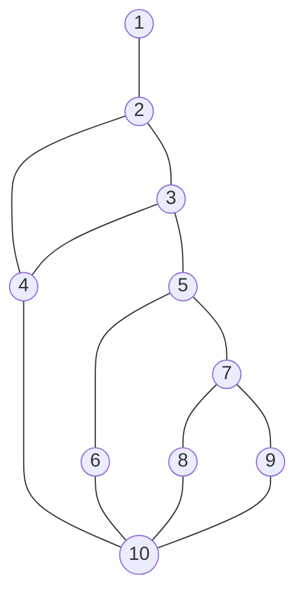
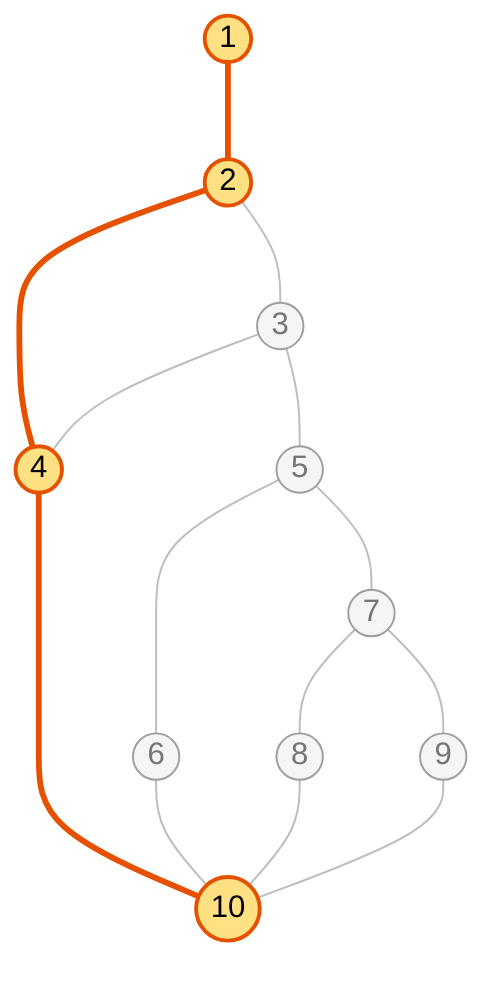
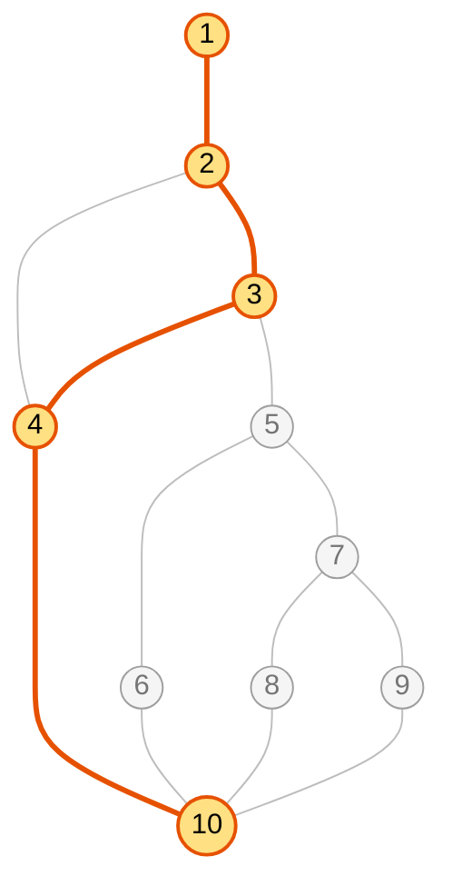
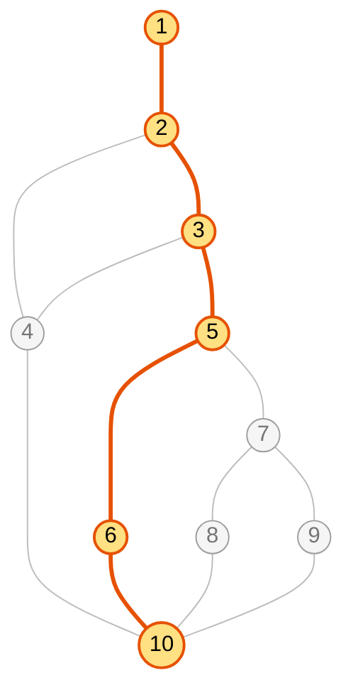
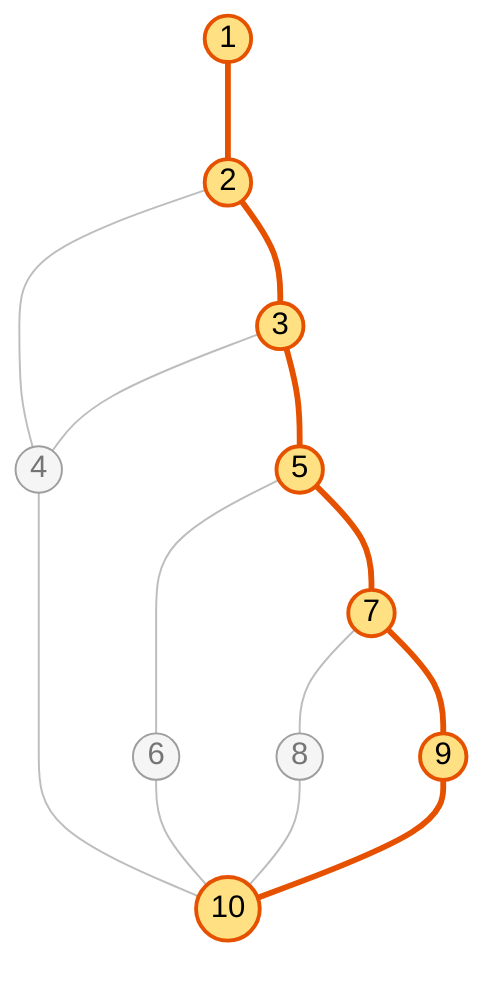
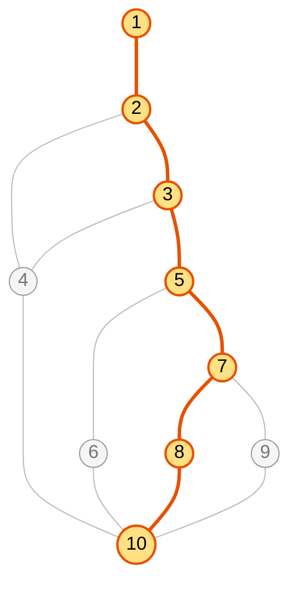

# Prueba de caja blanca 04 — `verificar_credenciales`

- **Módulo:** `itdb_ctf/auth/local_auth.py`
- **Función:** `verificar_credenciales(email, password) -> Usuario | None`
- **Propósito:** validar el ingreso con email y contraseña (login local). Solo
  acepta cuentas de método `local`, con contraseña definida y activas.
- **Técnica:** camino básico (McCabe) + cobertura de ramas con `pytest-cov`.
- **Archivo de pruebas:** `tests/test_04_verificar_credenciales.py`

---

## 1. Código fuente con nodos numerados

```python
 6  def verificar_credenciales(email, password):
 7      with Session(engine) as s:                                   # 1
 8          metodo_auth = ...where(etiqueta == "local").one()        # 1
 9          usuario = ...where(email_inst == email, metodo local)    # 1
11          if not usuario or not usuario.password_hash:             # 2 (not usuario) / 3 (sin hash)
12              return None                                          # 4
13          if not usuario.activo:                                   # 5
14              return None                                          # 6
15          if hasher.verificar(password, usuario.password_hash):    # 7 (bcrypt)
16              return usuario                                       # 8
17          return None                                              # 9
                                                                     # 10 (fin)
```

La condición compuesta de la línea 11 se separa en los nodos predicado 2 y 3.

## 2. Grafo de flujo



**Convención del grafo:** las aristas no llevan flecha ni etiqueta; el flujo va de arriba hacia abajo y converge en los nodos de unión y en el nodo final (10). De cada nodo predicado salen dos aristas: la de la **izquierda** corresponde a la condición verdadera (**sí**) y la de la **derecha** a la falsa (**no**).

## 3. Complejidad ciclomática V(G)

| Método | Cálculo | Resultado |
|---|---|---|
| Nodos predicado | P = 4 (nodos 2, 3, 5, 7) → V(G) = P + 1 | **5** |
| Aristas y nodos | E = 13, N = 10 → V(G) = 13 − 10 + 2 | **5** |
| Regiones | 4 cerradas + 1 exterior | **5** |

## 4. Caminos independientes

| Camino | Recorrido | Descripción |
|---|---|---|
| C1 | 1 → 2(sí) → 4 → 10 | No hay cuenta local con ese email |
| C2 | 1 → 2(no) → 3(sí) → 4 → 10 | Cuenta local sin contraseña (placeholder) |
| C3 | … → 3(no) → 5(sí) → 6 → 10 | Cuenta desactivada |
| C4 | … → 5(no) → 7(no) → 9 → 10 | Contraseña incorrecta |
| C5 | … → 5(no) → 7(sí) → 8 → 10 | Credenciales correctas |

Todos los caminos son factibles.

### 4.1 Grafo de cada camino

En cada grafo se resalta en naranja el recorrido del camino (nodos y
aristas); el resto del grafo queda en gris como referencia. Cada nodo
(círculo) es una sentencia o grupo de sentencias, numerado según el código
de la sección 1; el nodo 10 es el nodo final. Se usa la misma convención de la
sección 2 (izquierda = sí, derecha = no); en el recorrido escrito bajo cada
grafo, `(sí)`/`(no)` indica la salida que toma cada nodo predicado.

**C1 — No hay cuenta local con ese email**

`1 → 2(sí) → 4 → 10`



**C2 — Cuenta local sin contraseña (placeholder)**

`1 → 2(no) → 3(sí) → 4 → 10`



**C3 — Cuenta desactivada**

`1 → 2(no) → 3(no) → 5(sí) → 6 → 10`



**C4 — Contraseña incorrecta**

`1 → 2(no) → 3(no) → 5(no) → 7(no) → 9 → 10`



**C5 — Credenciales correctas**

`1 → 2(no) → 3(no) → 5(no) → 7(sí) → 8 → 10`



## 5. Casos de prueba

Cada caso parte de una BD vacía; la contraseña de prueba es `Clave_Segura_2026`,
guardada como hash bcrypt (igual que en la app).

C1 se prueba dos veces por partición de equivalencia: email que no existe, y
email que **sí** existe pero como cuenta de Google (la consulta filtra por método
`local`, así que tampoco se encuentra). Esto demuestra que una cuenta Google no
puede entrar por el formulario local.

| Caso | Test | Recorrido | Precondición | Entrada | Esperado | Obtenido |
|---|---|---|---|---|---|---|
| C1a | `test_C1_email_no_registrado` | 1 → 2 → 4 → 10 | BD sin usuarios | email inexistente | `None` | Aprobado |
| C1b | `test_C1b_cuenta_google_no_entra_por_login_local` | 1 → 2 → 4 → 10 | Cuenta Google con ese email | email + clave | `None` | Aprobado |
| C2 | `test_C2_cuenta_local_sin_contrasena` | 1 → 2 → 3 → 4 → 10 | Cuenta local con `password_hash = NULL` | email + clave | `None` | Aprobado |
| C3 | `test_C3_cuenta_inactiva` | 1 → 2 → 3 → 5 → 6 → 10 | Cuenta local, clave correcta, `activo = False` | email + clave | `None` | Aprobado |
| C4 | `test_C4_contrasena_incorrecta` | 1 → 2 → 3 → 5 → 7 → 9 → 10 | Cuenta local activa | email + `otra_clave` | `None` | Aprobado |
| C5 | `test_C5_credenciales_correctas` | 1 → 2 → 3 → 5 → 7 → 8 → 10 | Cuenta local activa | email + clave | el `Usuario` (mismo `id_usuario`) | Aprobado |

## 6. Resultados y cobertura

Ejecución: `pytest tests/test_04_verificar_credenciales.py --cov=itdb_ctf.auth.local_auth --cov-branch --cov-report=term-missing`
(2026-10-02, Python 3.14.5, pytest 9.1.1, BD `ctf_itdb_test`).

**6 de 6 casos aprobados.**

| Función | Sentencias cubiertas | Ramas parciales | Cobertura |
|---|---|---|---|
| `verificar_credenciales` | 11 / 11 | 0 | **100 %** |

## 7. Resumen de caminos

Un caso por camino independiente (V(G) = 5). La contraseña de prueba se guarda como hash bcrypt, igual que en la app.

| Camino | Precondición | Entrada | Resultado esperado |
|---|---|---|---|
| C1 | No hay usuarios registrados | `email = "nadie@itdonbosco.org"`, `password = "Clave_Segura_2026"` | `None` |
| C2 | Cuenta local `estudiante@itdonbosco.org` con `password_hash = NULL` | `email = "estudiante@itdonbosco.org"`, `password = "Clave_Segura_2026"` | `None` |
| C3 | Cuenta local con hash de `Clave_Segura_2026` y `activo = False` | `email = "estudiante@itdonbosco.org"`, `password = "Clave_Segura_2026"` | `None` |
| C4 | Cuenta local activa con hash de `Clave_Segura_2026` | `email = "estudiante@itdonbosco.org"`, `password = "otra_clave"` | `None` |
| C5 | Cuenta local activa con hash de `Clave_Segura_2026` | `email = "estudiante@itdonbosco.org"`, `password = "Clave_Segura_2026"` | `Usuario` con `id_usuario = 1` |

## 8. Recorrido de cada camino

Caminos independientes del conjunto base (V(G) = 5).

| Camino | Recorrido |
|---|---|
| C1 | 1 - 2 - 4 - 10 |
| C2 | 1 - 2 - 3 - 4 - 10 |
| C3 | 1 - 2 - 3 - 5 - 6 - 10 |
| C4 | 1 - 2 - 3 - 5 - 7 - 9 - 10 |
| C5 | 1 - 2 - 3 - 5 - 7 - 8 - 10 |

## 9. Código numerado por nodos

Renglones numerados de forma correlativa desde 1; el comentario indica el nodo del grafo de flujo que ocupa cada renglón (`# nodo # nodo` cuando hay más de uno). El último nodo `(fin)` no ocupa renglón: es la salida común de todos los `return`.

```python
1   def verificar_credenciales(email, password):
2       with Session(engine) as s:                                   # 1
3           metodo_auth = ...where(etiqueta == "local").one()        # 1
4           usuario = ...where(email_inst == email, metodo local)    # 1
5           if not usuario or not usuario.password_hash:             # 2 # 3
6               return None                                          # 4
7           if not usuario.activo:                                   # 5
8               return None                                          # 6
9           if hasher.verificar(password, usuario.password_hash):    # 7
10              return usuario                                       # 8
11          return None                                              # 9
                                                                     # 10 (fin)
```
