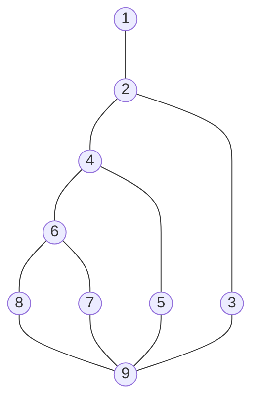
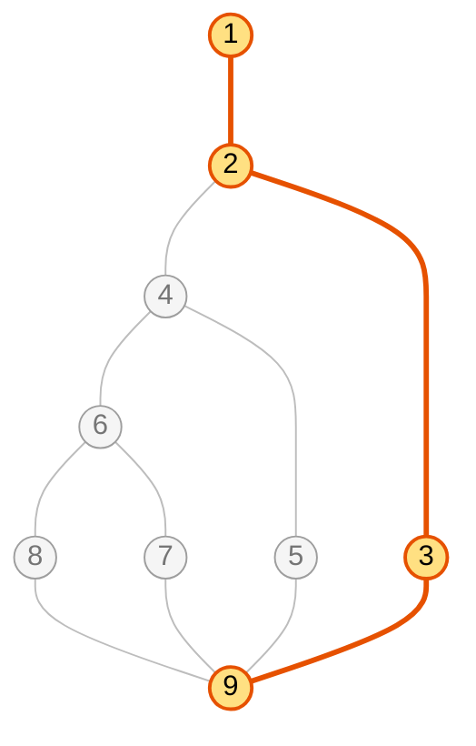
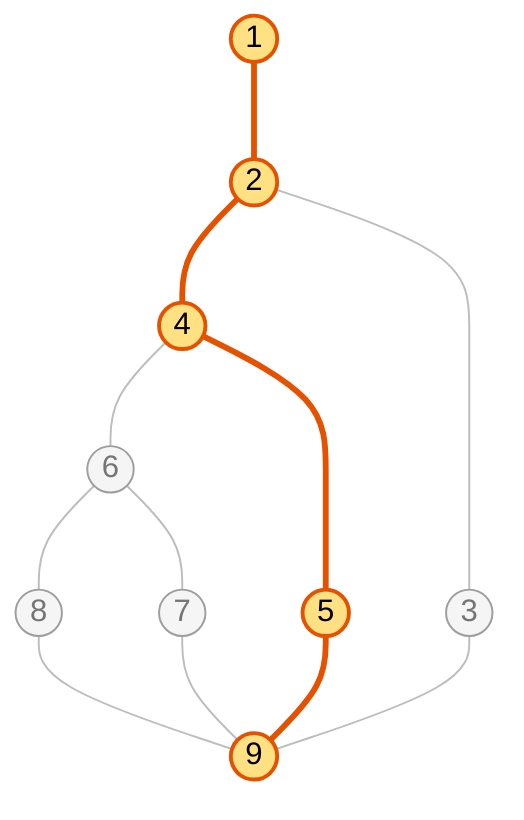
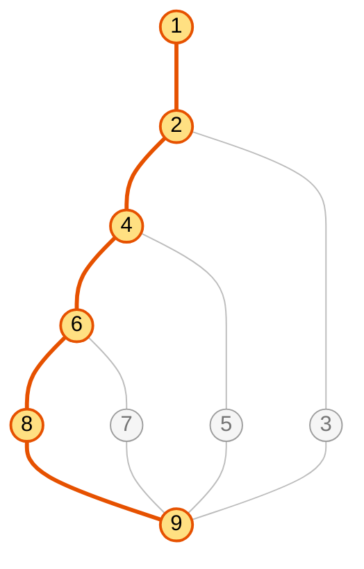
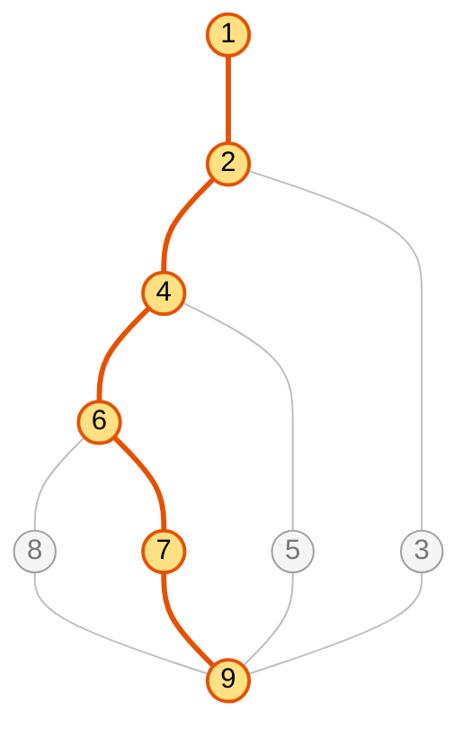

# Prueba de caja blanca 04 — `verificar_credenciales`

- **Módulo:** `itdb_ctf/auth/local_auth.py`
- **Función:** `verificar_credenciales(email, password) -> Usuario | None`
- **Propósito:** validar el ingreso con email y contraseña (login local). Solo
  acepta cuentas de método `local`, con contraseña definida y activas.
- **Técnica:** camino básico (McCabe) + cobertura de ramas con `pytest-cov`.
- **Archivo de pruebas:** `tests/test_04_verificar_credenciales.py`

---

## 1. Código fuente con nodos numerados

```python
6    def verificar_credenciales(email:str, password:str) -> Usuario | None:
7        with Session(engine) as s:                                                                                                             # 1
8            metodo_auth = s.exec(select(MetodoAuth).where(MetodoAuth.etiqueta=="local")).one()                                                 # 1
9            usuario = s.exec(select(Usuario).where(Usuario.email_inst==email, Usuario.id_metodo_auth == metodo_auth.id_metodo_auth)).first()   # 1
10
11           if not usuario or not usuario.password_hash:                                                                                       # 2
12               return None                                                                                                                    # 3
13           if not usuario.activo:                                                                                                             # 4
14               return None                                                                                                                    # 5
15           if hasher.verificar(password, usuario.password_hash):                                                                              # 6
16               return usuario                                                                                                                 # 7
17           return None                                                                                                                        # 8
                                                                                                                                                # 9 (fin)
```

**Condición compuesta.** El `if` de la línea 11 (`not usuario or not usuario.password_hash`) une varias condiciones con `or`. En Python, `or` se evalúa en cortocircuito: en cuanto una condición es verdadera, las siguientes no se evalúan. Según Watson y McCabe (1996, §4.1, p. 25), cada operador de cortocircuito suma un nodo de decisión; también permiten representar la condición completa como **un solo nodo predicado** (*"suppressing" short-circuit operators*), siempre que antes se verifique que las condiciones no tienen efectos secundarios (*"unless perhaps it is first verified that the short-circuit boolean expressions do not contain any side effects"*) y que el criterio se aplique de forma consistente.

**Verificación.** Ninguna de las dos condiciones modifica datos ni el estado del programa: `not usuario` comprueba si la consulta devolvió un registro y `not usuario.password_hash` lee un atributo de ese registro. Por eso el `if` se representa como **un solo nodo predicado (2)**, con dos salidas (verdadero / falso) y un único `return` (3). El mismo criterio se aplica a todas las condiciones compuestas de estas pruebas.

Las condiciones simples que hacen verdadero el nodo 2 se prueban como entradas distintas del mismo camino C1 (casos C1a y C1c; C1b es además otra partición de la entrada: el email existe pero como cuenta de Google), para que ninguna quede sin ejecutar al agruparlas en un solo nodo.

## 2. Grafo de flujo



**Convención del grafo:** las aristas no llevan flecha ni etiqueta; el flujo va de arriba hacia abajo y converge en los nodos de unión y en el nodo final (9). De cada nodo predicado salen dos aristas: la de la **derecha** corresponde a la condición **verdadera** y la de la **izquierda** a la **falsa**.

## 3. Complejidad ciclomática V(G)

| Método | Cálculo | Resultado |
|---|---|---|
| Nodos predicado | P = 3 (nodos 2, 4, 6) → V(G) = P + 1 | **4** |
| Aristas y nodos | E = 11, N = 9 → V(G) = 11 − 9 + 2 | **4** |
| Regiones | 3 cerradas + 1 exterior | **4** |

## 4. Caminos independientes

| Camino | Recorrido | Descripción |
|---|---|---|
| C1 | 1 → 2(verdadero) → 3 → 9 | Sin cuenta local utilizable (no existe o no tiene contraseña) |
| C2 | 1 → 2(falso) → 4(verdadero) → 5 → 9 | Cuenta desactivada |
| C3 | … → 4(falso) → 6(falso) → 8 → 9 | Contraseña incorrecta |
| C4 | … → 4(falso) → 6(verdadero) → 7 → 9 | Credenciales correctas |

Todos los caminos son factibles.

### 4.1 Grafo de cada camino

En cada grafo se resalta en naranja el recorrido del camino (nodos y
aristas); el resto del grafo queda en gris como referencia. Cada nodo
(círculo) es una sentencia o grupo de sentencias, numerado según el código
de la sección 1; el nodo 9 es el nodo final. Se usa la misma convención de la
sección 2 (derecha = verdadero, izquierda = falso); en el recorrido escrito bajo cada
grafo, `(verdadero)`/`(falso)` indica la salida que toma cada nodo predicado.

**C1 — Sin cuenta local utilizable (no existe o no tiene contraseña)**

`1 → 2(verdadero) → 3 → 9`



**C2 — Cuenta desactivada**

`1 → 2(falso) → 4(verdadero) → 5 → 9`



**C3 — Contraseña incorrecta**

`1 → 2(falso) → 4(falso) → 6(falso) → 8 → 9`



**C4 — Credenciales correctas**

`1 → 2(falso) → 4(falso) → 6(verdadero) → 7 → 9`


## 5. Casos de prueba

Cada caso parte de una BD vacía; la contraseña de prueba es `Clave_Segura_2026`,
guardada como hash bcrypt (igual que en la app).

El número de cada test es el de su camino; la letra (a, b, c) distingue las
entradas que recorren el mismo camino. C1 (nodo compuesto 2 verdadero) se prueba con tres
entradas: email que no existe; email que **sí** existe pero como cuenta de Google
(la consulta filtra por método `local`, así que tampoco se encuentra, lo que
demuestra que una cuenta Google no puede entrar por el formulario local); y
cuenta local sin contraseña (`not usuario.password_hash`).

**Casos con letra.** El criterio de McCabe exige probar V(G) caminos, no V(G) tests: *"no set of 4 paths will suffice for testing, even if […] there are 39 distinct tests that concentrate on the 4 paths"* (Watson y McCabe, 1996, §5.1, p. 31). Los casos con letra (a, b, c) **no son caminos nuevos**: recorren el mismo camino con otros datos de entrada, como recomienda la misma fuente: *"develop and execute several input data sets for each of the paths in the basis"* (§5.7). Por eso `pytest` cuenta más tests que caminos.

| Caso | Test | Recorrido | Precondición | Entrada | Esperado | Obtenido |
|---|---|---|---|---|---|---|
| C1a | `test_C1a_email_no_registrado` | 1 → 2 → 3 → 9 | BD sin usuarios | email inexistente | `None` | Aprobado |
| C1b | `test_C1b_cuenta_google_no_entra_por_login_local` | 1 → 2 → 3 → 9 | Cuenta Google con ese email | email + clave | `None` | Aprobado |
| C1c | `test_C1c_cuenta_local_sin_contrasena` | 1 → 2 → 3 → 9 | Cuenta local con `password_hash = NULL` | email + clave | `None` | Aprobado |
| C2 | `test_C2_cuenta_inactiva` | 1 → 2 → 4 → 5 → 9 | Cuenta local, clave correcta, `activo = False` | email + clave | `None` | Aprobado |
| C3 | `test_C3_contrasena_incorrecta` | 1 → 2 → 4 → 6 → 8 → 9 | Cuenta local activa | email + `otra_clave` | `None` | Aprobado |
| C4 | `test_C4_credenciales_correctas` | 1 → 2 → 4 → 6 → 7 → 9 | Cuenta local activa | email + clave | el `Usuario` (mismo `id_usuario`) | Aprobado |

## 6. Resultados y cobertura

Ejecución: `pytest tests/test_04_verificar_credenciales.py --cov=itdb_ctf.auth.local_auth --cov-branch --cov-report=term-missing`
(2026-10-02, Python 3.14.5, pytest 9.1.1, BD `ctf_itdb_test`).

**6 de 6 casos aprobados** para **4 caminos** (V(G) = 4): un caso por camino más 2 entradas adicionales (C1b y C1c) que recorren un camino ya probado.

| Función | Sentencias cubiertas | Ramas parciales | Cobertura |
|---|---|---|---|
| `verificar_credenciales` | 11 / 11 | 0 | **100 %** |

## 7. Resumen de caminos

Un caso por camino independiente (V(G) = 4). La contraseña de prueba se guarda como hash bcrypt, igual que en la app.

| Camino | Precondición | Entrada | Resultado esperado |
|---|---|---|---|
| C1 | No hay usuarios registrados | `email = "nadie@itdonbosco.org"`, `password = "Clave_Segura_2026"` | `None` |
| C2 | Cuenta local con hash de `Clave_Segura_2026` y `activo = False` | `email = "estudiante@itdonbosco.org"`, `password = "Clave_Segura_2026"` | `None` |
| C3 | Cuenta local activa con hash de `Clave_Segura_2026` | `email = "estudiante@itdonbosco.org"`, `password = "otra_clave"` | `None` |
| C4 | Cuenta local activa con hash de `Clave_Segura_2026` | `email = "estudiante@itdonbosco.org"`, `password = "Clave_Segura_2026"` | `Usuario` con `id_usuario = 1` |

## 8. Recorrido de cada camino

Caminos independientes del conjunto base (V(G) = 4).

| Camino | Recorrido |
|---|---|
| C1 | 1 - 2 - 3 - 9 |
| C2 | 1 - 2 - 4 - 5 - 9 |
| C3 | 1 - 2 - 4 - 6 - 8 - 9 |
| C4 | 1 - 2 - 4 - 6 - 7 - 9 |

## 9. Código numerado por nodos

Código completo de la función, renglón por renglón tal como está en el archivo (sin abreviar ni unir renglones), numerado de forma correlativa desde 1. El comentario de la derecha indica el nodo del grafo de flujo al que pertenece cada renglón (`# nodo # nodo` cuando un mismo renglón contiene más de un nodo); una sentencia que ocupa varios renglones pertenece toda al mismo nodo, y una condición compuesta (`or` / `and`) es un solo nodo. Los renglones sin nodo (la firma `def`, comentarios, docstring, líneas en blanco y `else:`) no son sentencias ejecutables. El último nodo `(fin)` no ocupa renglón: es la salida común de todos los `return`.

```python
1    def verificar_credenciales(email:str, password:str) -> Usuario | None:
2        with Session(engine) as s:                                                                                                             # 1
3            metodo_auth = s.exec(select(MetodoAuth).where(MetodoAuth.etiqueta=="local")).one()                                                 # 1
4            usuario = s.exec(select(Usuario).where(Usuario.email_inst==email, Usuario.id_metodo_auth == metodo_auth.id_metodo_auth)).first()   # 1
5
6            if not usuario or not usuario.password_hash:                                                                                       # 2
7                return None                                                                                                                    # 3
8            if not usuario.activo:                                                                                                             # 4
9                return None                                                                                                                    # 5
10           if hasher.verificar(password, usuario.password_hash):                                                                              # 6
11               return usuario                                                                                                                 # 7
12           return None                                                                                                                        # 8
                                                                                                                                                # 9 (fin)
```
