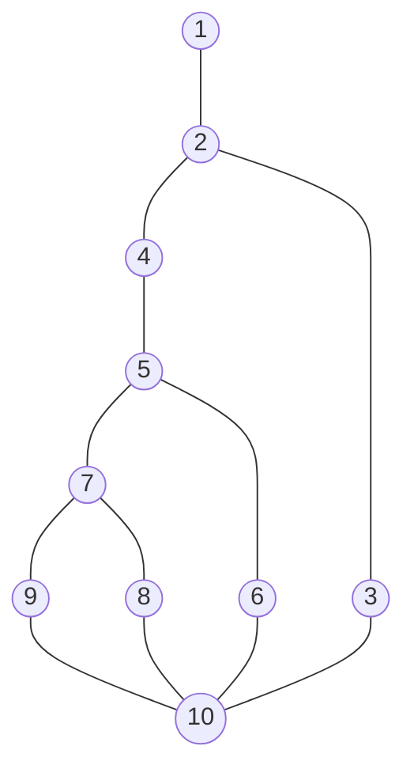
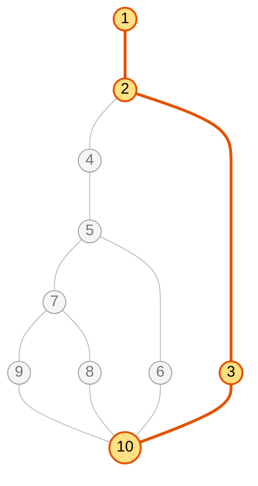
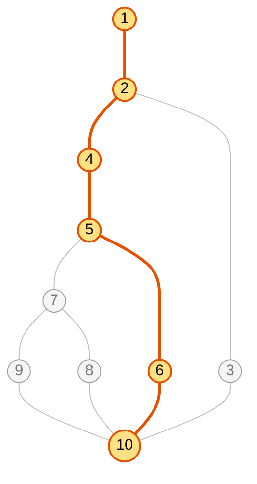
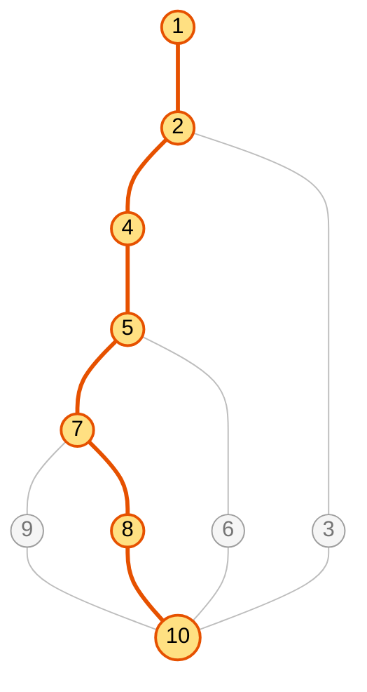
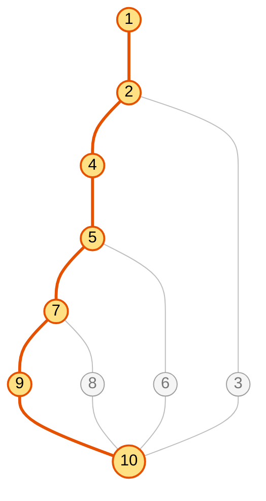

# Prueba de caja blanca 05 — `acceso_evento_cerrado`

- **Módulo:** `itdb_ctf/evento_cerrado/evento_cerrado_logic.py`
- **Función:** `acceso_evento_cerrado(id_evento, id_usuario) -> (bool, str)`
- **Propósito:** decidir si un estudiante puede entrar a los retos de un evento
  cerrado: el evento debe existir, estar activo, ser cerrado, estar en curso, y el
  estudiante debe estar inscrito y no descalificado.
- **Técnica:** camino básico (McCabe) + cobertura de ramas con `pytest-cov`.
- **Archivo de pruebas:** `tests/test_05_acceso_evento_cerrado.py`

---

## 1. Código fuente con nodos numerados

```python
21   def acceso_evento_cerrado(id_evento:int, id_usuario:int) -> tuple[bool,str]:
22       """Retos: solo para inscritos, y solo mientras el evento está activo (no se
23       puede jugar un evento que todavía no empezó o que ya concluyó)."""
24       with Session(engine) as s:                                                            # 1
25           ev = s.get(Evento, id_evento)                                                     # 1
26           if not ev or not ev.activo or etiqueta_modalidad(ev.id_modalidad) != "cerrado":   # 2
27               return False, "Evento no encontrado."                                         # 3
28           est = estado_evento(ev)                                                           # 4
29           if est == "concluido":                                                            # 5
30               return False, "Evento culminado."                                             # 6
31           if est == "futuro":                                                               # 7
32               return False, "El evento aún no inicia."                                      # 8
33           ok, msg = estado_inscripcion(id_usuario, id_evento)                               # 9
34
35           return ok, msg                                                                    # 9
                                                                                               # 10 (fin)
```

**Condición compuesta.** El `if` de la línea 26 (`not ev or not ev.activo or etiqueta_modalidad(ev.id_modalidad) != "cerrado"`) une varias condiciones con `or`. En Python, `or` se evalúa en cortocircuito: en cuanto una condición es verdadera, las siguientes no se evalúan. Según Watson y McCabe (1996, §4.1, p. 25), cada operador de cortocircuito suma un nodo de decisión; también permiten representar la condición completa como **un solo nodo predicado** (*"suppressing" short-circuit operators*), siempre que antes se verifique que las condiciones no tienen efectos secundarios (*"unless perhaps it is first verified that the short-circuit boolean expressions do not contain any side effects"*) y que el criterio se aplique de forma consistente.

**Verificación.** Ninguna de las tres condiciones modifica datos ni el estado del programa: `not ev` comprueba si `s.get` devolvió un registro, `not ev.activo` lee un atributo, y `etiqueta_modalidad` (`evento/evento_logic.py`, línea 25) solo hace una lectura (`s.get(Modalidad, …)`) y devuelve la etiqueta, sin escribir nada. Por eso el `if` se representa como **un solo nodo predicado (2)**, con dos salidas (verdadero / falso) y un único `return` (3). El mismo criterio se aplica a todas las condiciones compuestas de estas pruebas.

Las condiciones simples que hacen verdadero el nodo 2 se prueban como entradas distintas del mismo camino C1 (casos C1a, C1b y C1c), para que ninguna quede sin ejecutar al agruparlas en un solo nodo.

`estado_inscripcion` (9) es otra función que devuelve tres resultados posibles:
inscrito `(True, "")`, sin inscripción y descalificado. Dentro de este grafo es un
solo nodo, pero el camino C4 se prueba con sus **tres** salidas para comprobar que
el resultado se devuelve tal cual.

## 2. Grafo de flujo



**Convención del grafo:** las aristas no llevan flecha ni etiqueta; el flujo va de arriba hacia abajo y converge en los nodos de unión y en el nodo final (10). De cada nodo predicado salen dos aristas: la de la **derecha** corresponde a la condición **verdadera** y la de la **izquierda** a la **falsa**.

## 3. Complejidad ciclomática V(G)

| Método | Cálculo | Resultado |
|---|---|---|
| Nodos predicado | P = 3 (nodos 2, 5, 7) → V(G) = P + 1 | **4** |
| Aristas y nodos | E = 12, N = 10 → V(G) = 12 − 10 + 2 | **4** |
| Regiones | 3 cerradas + 1 exterior | **4** |

## 4. Caminos independientes

| Camino | Recorrido | Descripción |
|---|---|---|
| C1 | 1 → 2(verdadero) → 3 → 10 | Evento no válido (no existe, desactivado o no es cerrado) |
| C2 | 1 → 2(falso) → 4 → 5(verdadero) → 6 → 10 | El evento ya terminó |
| C3 | … → 5(falso) → 7(verdadero) → 8 → 10 | El evento aún no empieza |
| C4 | … → 5(falso) → 7(falso) → 9 → 10 | Evento en curso: decide la inscripción |

Todos los caminos son factibles.

### 4.1 Grafo de cada camino

En cada grafo se resalta en naranja el recorrido del camino (nodos y
aristas); el resto del grafo queda en gris como referencia. Cada nodo
(círculo) es una sentencia o grupo de sentencias, numerado según el código
de la sección 1; el nodo 10 es el nodo final. Se usa la misma convención de la
sección 2 (derecha = verdadero, izquierda = falso); en el recorrido escrito bajo cada
grafo, `(verdadero)`/`(falso)` indica la salida que toma cada nodo predicado.

**C1 — Evento no válido (no existe, desactivado o no es cerrado)**

`1 → 2(verdadero) → 3 → 10`



**C2 — El evento ya terminó**

`1 → 2(falso) → 4 → 5(verdadero) → 6 → 10`



**C3 — El evento aún no empieza**

`1 → 2(falso) → 4 → 5(falso) → 7(verdadero) → 8 → 10`



**C4 — Evento en curso: decide la inscripción**

`1 → 2(falso) → 4 → 5(falso) → 7(falso) → 9 → 10`


## 5. Casos de prueba

En C1b a C3 el estudiante **está inscrito**, para demostrar que lo bloquea el
estado del evento y no la falta de inscripción.

El número de cada test es el de su camino; la letra (a, b, c) distingue las
entradas que recorren el mismo camino.

**Casos con letra.** El criterio de McCabe exige probar V(G) caminos, no V(G) tests: *"no set of 4 paths will suffice for testing, even if […] there are 39 distinct tests that concentrate on the 4 paths"* (Watson y McCabe, 1996, §5.1, p. 31). Los casos con letra (a, b, c) **no son caminos nuevos**: recorren el mismo camino con otros datos de entrada, como recomienda la misma fuente: *"develop and execute several input data sets for each of the paths in the basis"* (§5.7). Por eso `pytest` cuenta más tests que caminos.

| Caso | Test | Recorrido | Precondición | Esperado | Obtenido |
|---|---|---|---|---|---|
| C1a | `test_C1a_evento_inexistente` | 1 → 2 → 3 → 10 | `id_evento = 9999` (`not ev`) | `(False, "Evento no encontrado.")` | Aprobado |
| C1b | `test_C1b_evento_desactivado` | 1 → 2 → 3 → 10 | Evento cerrado en curso con `activo = False` (`not ev.activo`) | `(False, "Evento no encontrado.")` | Aprobado |
| C1c | `test_C1c_evento_abierto_no_es_cerrado` | 1 → 2 → 3 → 10 | Evento de modalidad abierta (`!= "cerrado"`) | `(False, "Evento no encontrado.")` | Aprobado |
| C2 | `test_C2_evento_concluido` | 1 → 2 → 4 → 5 → 6 → 10 | Evento que terminó ayer | `(False, "Evento culminado.")` | Aprobado |
| C3 | `test_C3_evento_futuro` | 1 → 2 → 4 → 5 → 7 → 8 → 10 | Evento que empieza mañana | `(False, "El evento aún no inicia.")` | Aprobado |
| C4a | `test_C4_…[inscrito]` | 1 → 2 → 4 → 5 → 7 → 9 → 10 | Evento en curso, estudiante inscrito | `(True, "")` | Aprobado |
| C4b | `test_C4_…[sin_inscripcion]` | 1 → 2 → 4 → 5 → 7 → 9 → 10 | Evento en curso, sin inscripción | `(False, "No estás inscrito en este evento.")` | Aprobado |
| C4c | `test_C4_…[descalificado]` | 1 → 2 → 4 → 5 → 7 → 9 → 10 | Evento en curso, estudiante descalificado | `(False, "Has sido descalificado del evento.")` | Aprobado |

## 6. Resultados y cobertura

Ejecución: `pytest tests/test_05_acceso_evento_cerrado.py --cov=itdb_ctf.evento_cerrado.evento_cerrado_logic --cov-branch --cov-report=term-missing`
(2026-10-02, Python 3.14.5, pytest 9.1.1, BD `ctf_itdb_test`).

**8 de 8 casos aprobados** para **4 caminos** (V(G) = 4): un caso por camino más 4 entradas adicionales (C1b, C1c, C4b y C4c) que recorren un camino ya probado.

| Función | Sentencias cubiertas | Ramas parciales | Cobertura |
|---|---|---|---|
| `acceso_evento_cerrado` (líneas 21–35) | 12 / 12 | 0 | **100 %** |

El reporte de `pytest-cov` muestra el archivo completo al 60 %: las líneas sin
cubrir (40-46, 52-56, 60-64) son de `acceso_publico_evento_cerrado` y
`acceso_perfil_evento_cerrado`, que no forman parte de esta prueba.

## 7. Resumen de caminos

Un caso por camino independiente (V(G) = 4). Escenario base: usuario 1 (admin) y usuario 2 (estudiante). En C2 a C4 el usuario 2 está inscrito en el evento 1.

| Camino | Precondición | Entrada | Resultado esperado |
|---|---|---|---|
| C1 | No existe el evento 9999 | `id_evento = 9999`, `id_usuario = 2` | `(False, "Evento no encontrado.")` |
| C2 | Evento 1 cerrado con `fec_fin` = ayer | `id_evento = 1`, `id_usuario = 2` | `(False, "Evento culminado.")` |
| C3 | Evento 1 cerrado con `fec_inicio` = mañana | `id_evento = 1`, `id_usuario = 2` | `(False, "El evento aún no inicia.")` |
| C4 | Evento 1 cerrado, en curso | `id_evento = 1`, `id_usuario = 2` | `(True, "")` |

## 8. Recorrido de cada camino

Caminos independientes del conjunto base (V(G) = 4).

| Camino | Recorrido |
|---|---|
| C1 | 1 - 2 - 3 - 10 |
| C2 | 1 - 2 - 4 - 5 - 6 - 10 |
| C3 | 1 - 2 - 4 - 5 - 7 - 8 - 10 |
| C4 | 1 - 2 - 4 - 5 - 7 - 9 - 10 |

## 9. Código numerado por nodos

Código completo de la función, renglón por renglón tal como está en el archivo (sin abreviar ni unir renglones), numerado de forma correlativa desde 1. El comentario de la derecha indica el nodo del grafo de flujo al que pertenece cada renglón (`# nodo # nodo` cuando un mismo renglón contiene más de un nodo); una sentencia que ocupa varios renglones pertenece toda al mismo nodo, y una condición compuesta (`or` / `and`) es un solo nodo. Los renglones sin nodo (la firma `def`, comentarios, docstring, líneas en blanco y `else:`) no son sentencias ejecutables. El último nodo `(fin)` no ocupa renglón: es la salida común de todos los `return`.

```python
1    def acceso_evento_cerrado(id_evento:int, id_usuario:int) -> tuple[bool,str]:
2        """Retos: solo para inscritos, y solo mientras el evento está activo (no se
3        puede jugar un evento que todavía no empezó o que ya concluyó)."""
4        with Session(engine) as s:                                                            # 1
5            ev = s.get(Evento, id_evento)                                                     # 1
6            if not ev or not ev.activo or etiqueta_modalidad(ev.id_modalidad) != "cerrado":   # 2
7                return False, "Evento no encontrado."                                         # 3
8            est = estado_evento(ev)                                                           # 4
9            if est == "concluido":                                                            # 5
10               return False, "Evento culminado."                                             # 6
11           if est == "futuro":                                                               # 7
12               return False, "El evento aún no inicia."                                      # 8
13           ok, msg = estado_inscripcion(id_usuario, id_evento)                               # 9
14
15           return ok, msg                                                                    # 9
                                                                                               # 10 (fin)
```
