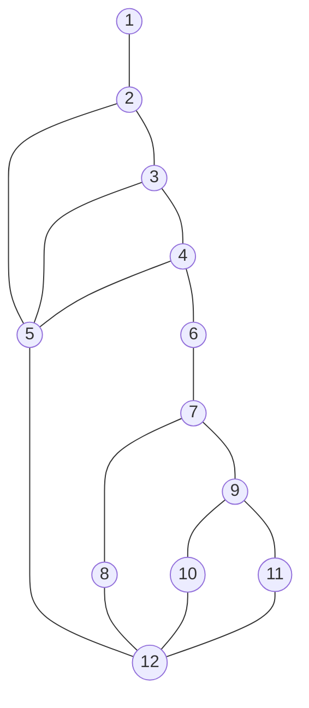
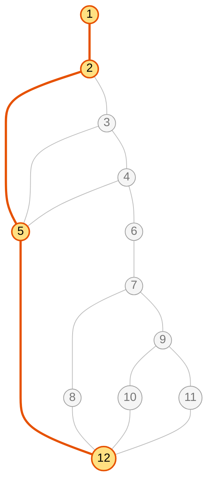
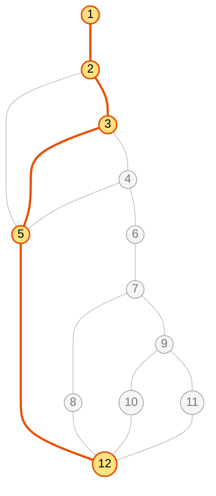
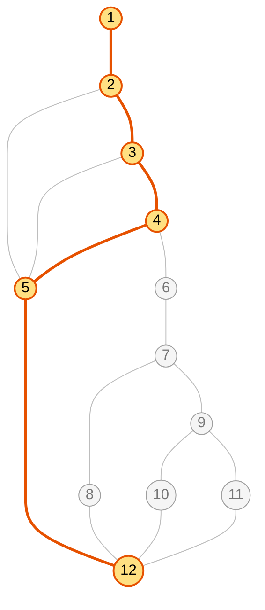
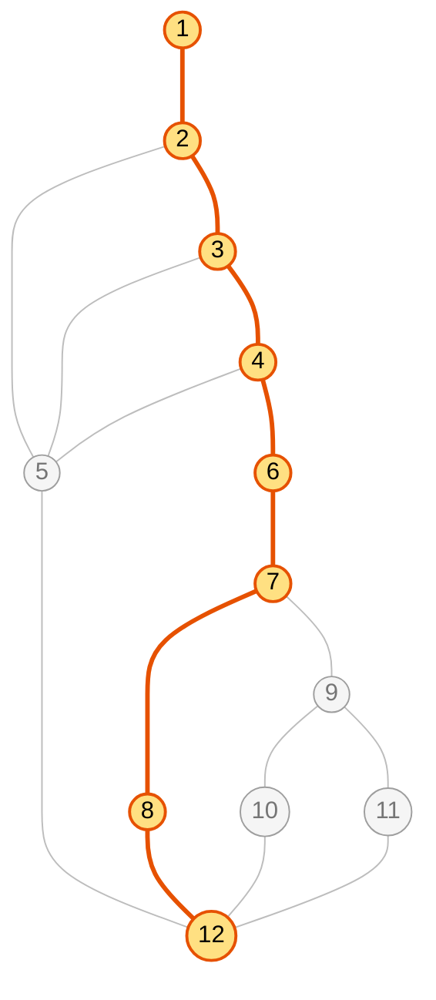
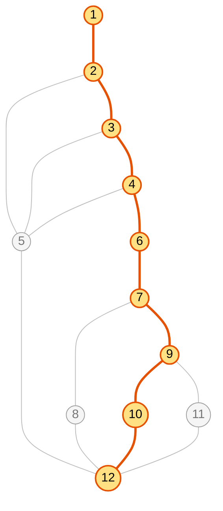
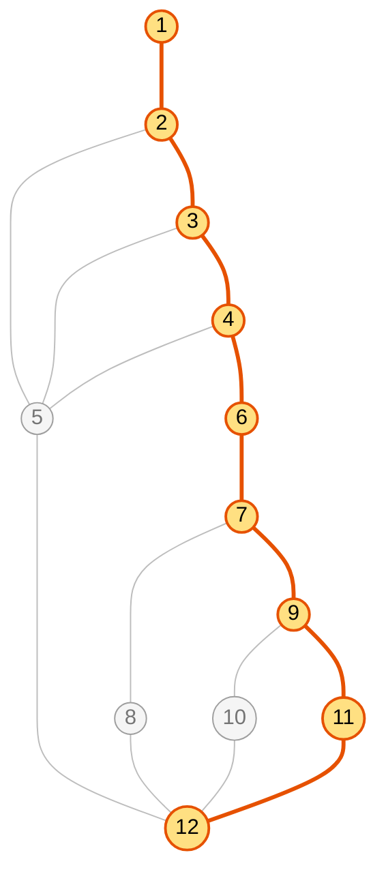

# Prueba de caja blanca 05 — `acceso_evento_cerrado`

- **Módulo:** `itdb_ctf/evento_cerrado/evento_cerrado_logic.py`
- **Función:** `acceso_evento_cerrado(id_evento, id_usuario) -> (bool, str)`
- **Propósito:** decidir si un estudiante puede entrar a los retos de un evento
  cerrado: el evento debe existir, estar activo, ser cerrado, estar en curso, y el
  estudiante debe estar inscrito y no descalificado.
- **Técnica:** camino básico (McCabe) + cobertura de ramas con `pytest-cov`.
- **Archivo de pruebas:** `tests/test_05_acceso_evento_cerrado.py`

---

## 1. Código fuente con nodos numerados

```python
21  def acceso_evento_cerrado(id_evento, id_usuario):
24      with Session(engine) as s:                                   # 1
25          ev = s.get(Evento, id_evento)                            # 1
26          if not ev or not ev.activo or etiqueta_modalidad(...) != "cerrado":
                                                                     # 2 / 3 / 4
27              return False, "Evento no encontrado."                # 5
28          est = estado_evento(ev)                                  # 6
29          if est == "concluido":                                   # 7
30              return False, "Evento culminado."                    # 8
31          if est == "futuro":                                      # 9
32              return False, "El evento aún no inicia."             # 10
33-35       ok, msg = estado_inscripcion(...); return ok, msg        # 11
                                                                     # 12 (fin)
```

La condición de la línea 26 tiene tres partes y se separa en los nodos predicado 2 (no existe),
3 (desactivado) y 4 (no es cerrado).

`estado_inscripcion` (11) es otra función que devuelve tres resultados posibles:
inscrito `(True, "")`, sin inscripción y descalificado. Dentro de este grafo es un
solo nodo, pero el camino C6 se prueba con sus **tres** salidas para comprobar que
el resultado se devuelve tal cual.

## 2. Grafo de flujo



**Convención del grafo:** las aristas no llevan flecha ni etiqueta; el flujo va de arriba hacia abajo y converge en los nodos de unión y en el nodo final (12). De cada nodo predicado salen dos aristas: la de la **izquierda** corresponde a la condición verdadera (**sí**) y la de la **derecha** a la falsa (**no**).

## 3. Complejidad ciclomática V(G)

| Método | Cálculo | Resultado |
|---|---|---|
| Nodos predicado | P = 5 (nodos 2, 3, 4, 7, 9) → V(G) = P + 1 | **6** |
| Aristas y nodos | E = 16, N = 12 → V(G) = 16 − 12 + 2 | **6** |
| Regiones | 5 cerradas + 1 exterior | **6** |

## 4. Caminos independientes

| Camino | Recorrido | Descripción |
|---|---|---|
| C1 | 1 → 2(sí) → 5 → 12 | El evento no existe |
| C2 | 1 → 2(no) → 3(sí) → 5 → 12 | El evento está desactivado |
| C3 | … → 3(no) → 4(sí) → 5 → 12 | El evento es el abierto, no uno cerrado |
| C4 | … → 4(no) → 6 → 7(sí) → 8 → 12 | El evento ya terminó |
| C5 | … → 7(no) → 9(sí) → 10 → 12 | El evento aún no empieza |
| C6 | … → 9(no) → 11 → 12 | Evento en curso: decide la inscripción |

Todos los caminos son factibles.

### 4.1 Grafo de cada camino

En cada grafo se resalta en naranja el recorrido del camino (nodos y
aristas); el resto del grafo queda en gris como referencia. Cada nodo
(círculo) es una sentencia o grupo de sentencias, numerado según el código
de la sección 1; el nodo 12 es el nodo final. Se usa la misma convención de la
sección 2 (izquierda = sí, derecha = no); en el recorrido escrito bajo cada
grafo, `(sí)`/`(no)` indica la salida que toma cada nodo predicado.

**C1 — El evento no existe**

`1 → 2(sí) → 5 → 12`



**C2 — El evento está desactivado**

`1 → 2(no) → 3(sí) → 5 → 12`



**C3 — El evento es el abierto, no uno cerrado**

`1 → 2(no) → 3(no) → 4(sí) → 5 → 12`



**C4 — El evento ya terminó**

`1 → 2(no) → 3(no) → 4(no) → 6 → 7(sí) → 8 → 12`



**C5 — El evento aún no empieza**

`1 → 2(no) → 3(no) → 4(no) → 6 → 7(no) → 9(sí) → 10 → 12`



**C6 — Evento en curso: decide la inscripción**

`1 → 2(no) → 3(no) → 4(no) → 6 → 7(no) → 9(no) → 11 → 12`



## 5. Casos de prueba

En C2 a C5 el estudiante **está inscrito**, para demostrar que lo bloquea el
estado del evento y no la falta de inscripción.

| Caso | Test | Recorrido | Precondición | Esperado | Obtenido |
|---|---|---|---|---|---|
| C1 | `test_C1_evento_inexistente` | 1 → 2 → 5 → 12 | `id_evento = 9999` | `(False, "Evento no encontrado.")` | Aprobado |
| C2 | `test_C2_evento_desactivado` | 1 → 2 → 3 → 5 → 12 | Evento cerrado en curso con `activo = False` | `(False, "Evento no encontrado.")` | Aprobado |
| C3 | `test_C3_evento_abierto_no_es_cerrado` | 1 → 2 → 3 → 4 → 5 → 12 | Evento de modalidad abierta | `(False, "Evento no encontrado.")` | Aprobado |
| C4 | `test_C4_evento_concluido` | 1 → 2 → 3 → 4 → 6 → 7 → 8 → 12 | Evento que terminó ayer | `(False, "Evento culminado.")` | Aprobado |
| C5 | `test_C5_evento_futuro` | 1 → 2 → 3 → 4 → 6 → 7 → 9 → 10 → 12 | Evento que empieza mañana | `(False, "El evento aún no inicia.")` | Aprobado |
| C6a | `test_C6_…[inscrito]` | 1 → 2 → 3 → 4 → 6 → 7 → 9 → 11 → 12 | Evento en curso, estudiante inscrito | `(True, "")` | Aprobado |
| C6b | `test_C6_…[sin_inscripcion]` | 1 → 2 → 3 → 4 → 6 → 7 → 9 → 11 → 12 | Evento en curso, sin inscripción | `(False, "No estas inscrito en este evento.")` | Aprobado |
| C6c | `test_C6_…[descalificado]` | 1 → 2 → 3 → 4 → 6 → 7 → 9 → 11 → 12 | Evento en curso, estudiante descalificado | `(False, "Has sido desacalificado de el evento.")` | Aprobado |

## 6. Resultados y cobertura

Ejecución: `pytest tests/test_05_acceso_evento_cerrado.py --cov=itdb_ctf.evento_cerrado.evento_cerrado_logic --cov-branch --cov-report=term-missing`
(2026-10-02, Python 3.14.5, pytest 9.1.1, BD `ctf_itdb_test`).

**8 de 8 casos aprobados.**

| Función | Sentencias cubiertas | Ramas parciales | Cobertura |
|---|---|---|---|
| `acceso_evento_cerrado` (líneas 21–35) | 12 / 12 | 0 | **100 %** |

El reporte de `pytest-cov` muestra el archivo completo al 60 %: las líneas sin
cubrir (40-46, 52-56, 60-64) son de `acceso_publico_evento_cerrado` y
`acceso_perfil_evento_cerrado`, que no forman parte de esta prueba.

## 7. Resumen de caminos

Un caso por camino independiente (V(G) = 6). Escenario base: usuario 1 (admin) y usuario 2 (estudiante). En C2 a C6 el usuario 2 está inscrito en el evento 1.

| Camino | Precondición | Entrada | Resultado esperado |
|---|---|---|---|
| C1 | No existe el evento 9999 | `id_evento = 9999`, `id_usuario = 2` | `(False, "Evento no encontrado.")` |
| C2 | Evento 1 cerrado, en curso, con `activo = False` | `id_evento = 1`, `id_usuario = 2` | `(False, "Evento no encontrado.")` |
| C3 | Evento 1 de modalidad abierta | `id_evento = 1`, `id_usuario = 2` | `(False, "Evento no encontrado.")` |
| C4 | Evento 1 cerrado con `fec_fin` = ayer | `id_evento = 1`, `id_usuario = 2` | `(False, "Evento culminado.")` |
| C5 | Evento 1 cerrado con `fec_inicio` = mañana | `id_evento = 1`, `id_usuario = 2` | `(False, "El evento aún no inicia.")` |
| C6 | Evento 1 cerrado, en curso | `id_evento = 1`, `id_usuario = 2` | `(True, "")` |

## 8. Recorrido de cada camino

Caminos independientes del conjunto base (V(G) = 6).

| Camino | Recorrido |
|---|---|
| C1 | 1 - 2 - 5 - 12 |
| C2 | 1 - 2 - 3 - 5 - 12 |
| C3 | 1 - 2 - 3 - 4 - 5 - 12 |
| C4 | 1 - 2 - 3 - 4 - 6 - 7 - 8 - 12 |
| C5 | 1 - 2 - 3 - 4 - 6 - 7 - 9 - 10 - 12 |
| C6 | 1 - 2 - 3 - 4 - 6 - 7 - 9 - 11 - 12 |

## 9. Código numerado por nodos

Renglones numerados de forma correlativa desde 1; el comentario indica el nodo del grafo de flujo que ocupa cada renglón (`# nodo # nodo` cuando hay más de uno). El último nodo `(fin)` no ocupa renglón: es la salida común de todos los `return`.

```python
1   def acceso_evento_cerrado(id_evento, id_usuario):
2       with Session(engine) as s:                                   # 1
3           ev = s.get(Evento, id_evento)                            # 1
4           if not ev or not ev.activo or etiqueta_modalidad(...) != "cerrado":  # 2 # 3 # 4
5               return False, "Evento no encontrado."                # 5
6           est = estado_evento(ev)                                  # 6
7           if est == "concluido":                                   # 7
8               return False, "Evento culminado."                    # 8
9           if est == "futuro":                                      # 9
10              return False, "El evento aún no inicia."             # 10
11          ok, msg = estado_inscripcion(...); return ok, msg        # 11
                                                                     # 12 (fin)
```
