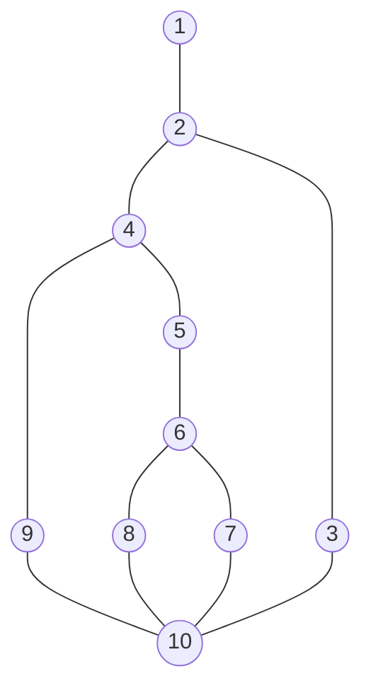
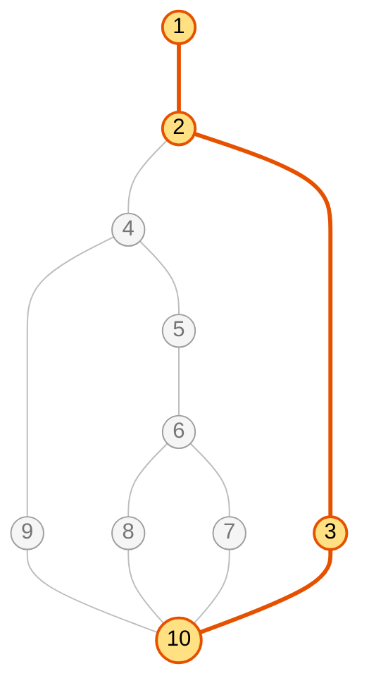
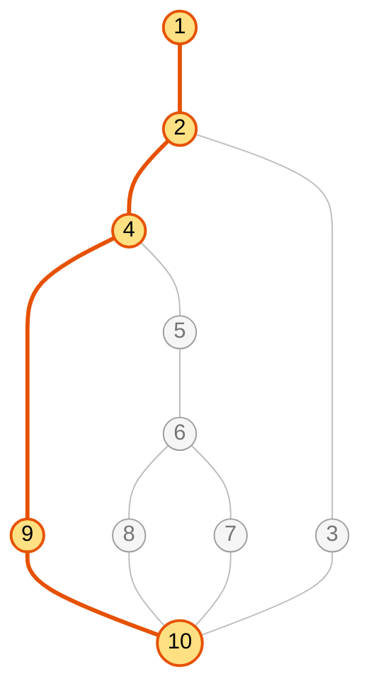
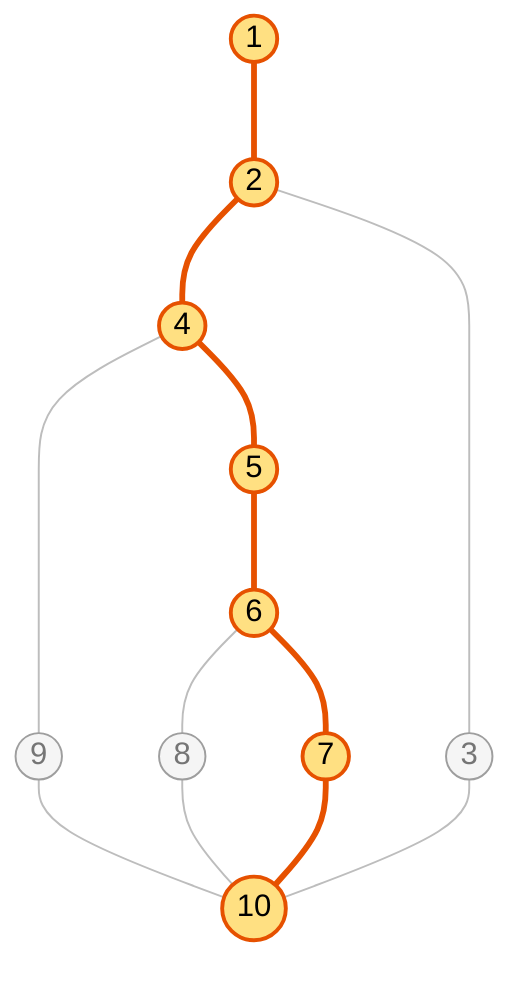
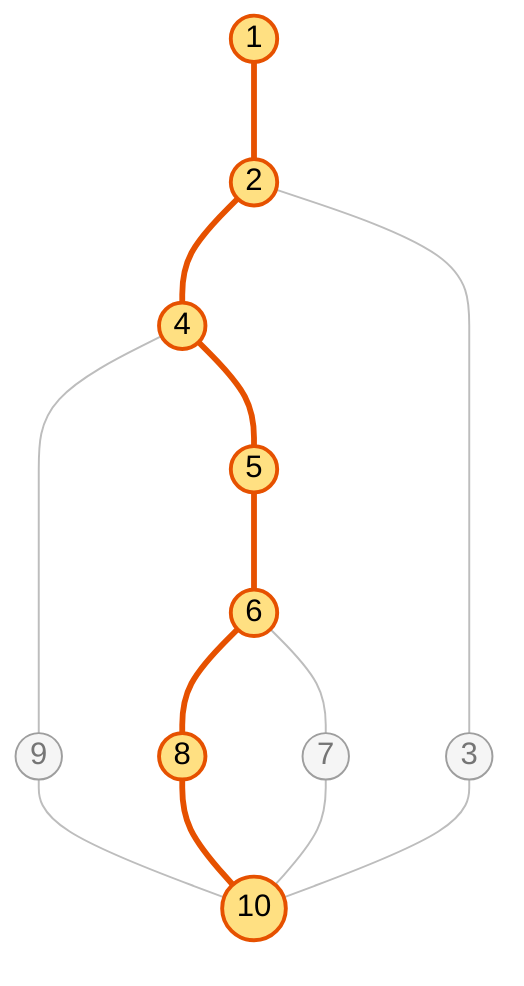

# Prueba de caja blanca 06 — `permitir_flag` (rate limit de flags)

- **Módulo:** `itdb_ctf/core/rate_limit.py`
- **Función:** `permitir_flag(id_usuario, id_reto) -> (permitido: bool, segundos_restantes: int)`
- **Propósito:** frenar la fuerza bruta de flags: máximo **15 envíos por minuto**
  por cada par (usuario, reto). El contador vive en Redis; si Redis no está, se
  permite el envío (*fail-open*) para no bloquear la competencia.
- **Técnica:** camino básico (McCabe) + cobertura de ramas con `pytest-cov`.
- **Archivo de pruebas:** `tests/test_06_permitir_flag.py`

---

## 1. Código fuente con nodos numerados

```python
177  def permitir_flag(id_usuario: int, id_reto: int) -> "tuple[bool, int]":
178      clave = _clave_flag(id_usuario, id_reto)                              # 1
179      limite, ventana = FLAG                                                # 1
180      n = _redis_incr(clave, ventana)                                       # 1
181      if n is None:                                                         # 2
182          return True, 0   # fail-open                                      # 3
183      if n > limite:                                                        # 4
184          r = _redis_peek(clave)                                            # 5
185          return False, (r[1] if r else ventana)                            # 6 # 7 # 8
186      return True, 0                                                        # 9
                                                                               # 10 (fin)
```

La línea 185 contiene un `if` en una sola línea (operador ternario); McCabe lo
cuenta como un nodo predicado más (6).

## 2. Grafo de flujo



**Convención del grafo:** las aristas no llevan flecha ni etiqueta; el flujo va de arriba hacia abajo y converge en los nodos de unión y en el nodo final (10). De cada nodo predicado salen dos aristas: la de la **derecha** corresponde a la condición **verdadera** y la de la **izquierda** a la **falsa**.

## 3. Complejidad ciclomática V(G)

| Método | Cálculo | Resultado |
|---|---|---|
| Nodos predicado | P = 3 (nodos 2, 4, 6) → V(G) = P + 1 | **4** |
| Aristas y nodos | E = 12, N = 10 → V(G) = 12 − 10 + 2 | **4** |
| Regiones | 3 cerradas + 1 exterior | **4** |

## 4. Caminos independientes

| Camino | Recorrido | Descripción |
|---|---|---|
| C1 | 1 → 2(verdadero) → 3 → 10 | Redis caído → se permite (fail-open) |
| C2 | 1 → 2(falso) → 4(falso) → 9 → 10 | Dentro del límite → se permite |
| C3 | … → 4(verdadero) → 5 → 6(verdadero) → 7 → 10 | Superó el límite → bloquea con el tiempo restante real |
| C4 | … → 4(verdadero) → 5 → 6(falso) → 8 → 10 | Superó el límite y Redis falla al consultar el tiempo → bloquea 60 s |

Todos los caminos son factibles. C4 ocurre si Redis se cae justo entre el
conteo y la consulta del tiempo; en la prueba se simula reemplazando
`_redis_peek` por una función que devuelve `None` (técnica de *stub*).

### 4.1 Grafo de cada camino

En cada grafo se resalta en naranja el recorrido del camino (nodos y
aristas); el resto del grafo queda en gris como referencia. Cada nodo
(círculo) es una sentencia o grupo de sentencias, numerado según el código
de la sección 1; el nodo 10 es el nodo final. Se usa la misma convención de la
sección 2 (derecha = verdadero, izquierda = falso); en el recorrido escrito bajo cada
grafo, `(verdadero)`/`(falso)` indica la salida que toma cada nodo predicado.

**C1 — Redis caído → se permite (fail-open)**

`1 → 2(verdadero) → 3 → 10`



**C2 — Dentro del límite → se permite**

`1 → 2(falso) → 4(falso) → 9 → 10`



**C3 — Superó el límite → bloquea con el tiempo restante real**

`1 → 2(falso) → 4(verdadero) → 5 → 6(verdadero) → 7 → 10`



**C4 — Superó el límite y falla la consulta del tiempo → bloquea 60 s**

`1 → 2(falso) → 4(verdadero) → 5 → 6(falso) → 8 → 10`



## 5. Casos de prueba

Redis es reemplazado por `fakeredis` (Redis en memoria), que se vacía antes de
cada caso. Para C1 se marca Redis como caído.

C2 aplica **valor límite**: el 1.er intento y el 15.º (el último permitido).
C3 prueba el 16.º (el primero bloqueado) y además que otro reto tiene su propio
contador.

**Casos con letra.** El criterio de McCabe exige probar V(G) caminos, no V(G) tests: *"no set of 4 paths will suffice for testing, even if […] there are 39 distinct tests that concentrate on the 4 paths"* (Watson y McCabe, 1996, §5.1, p. 31). Los casos con letra (a, b, c) **no son caminos nuevos**: recorren el mismo camino con otros datos de entrada, como recomienda la misma fuente: *"develop and execute several input data sets for each of the paths in the basis"* (§5.7). Por eso `pytest` cuenta más tests que caminos.

| Caso | Test | Recorrido | Precondición | Entrada | Esperado | Obtenido |
|---|---|---|---|---|---|---|
| C1 | `test_C1_sin_redis_permite` | 1 → 2 → 3 → 10 | Redis caído | 20 intentos | todos `(True, 0)` | Aprobado |
| C2a | `test_C2_dentro_del_limite[primer_intento]` | 1 → 2 → 4 → 9 → 10 | Contador en 0 | intento 1 | `(True, 0)` | Aprobado |
| C2b | `test_C2_dentro_del_limite[intento_15_limite]` | 1 → 2 → 4 → 9 → 10 | 14 intentos previos | intento 15 | `(True, 0)` | Aprobado |
| C3 | `test_C3_supera_limite` | 1 → 2 → 4 → 5 → 6 → 7 → 10 | 15 intentos previos | intento 16 | `(False, t)` con 1 ≤ t ≤ 60; otro reto sigue `(True, 0)` | Aprobado |
| C4 | `test_C4_supera_limite_y_falla_la_consulta_del_ttl` | 1 → 2 → 4 → 5 → 6 → 8 → 10 | 15 intentos previos, `_redis_peek` devuelve `None` | intento 16 | `(False, 60)` | Aprobado |

## 6. Resultados y cobertura

Ejecución: `pytest tests/test_06_permitir_flag.py --cov=itdb_ctf.core.rate_limit --cov-branch --cov-report=term-missing`
(2026-10-02, Python 3.14.5, pytest 9.1.1).

**5 de 5 casos aprobados** para **4 caminos** (V(G) = 4): un caso por camino más 1 entrada adicional (C2b) que recorre un camino ya probado.

| Función | Sentencias cubiertas | Ramas parciales | Cobertura |
|---|---|---|---|
| `permitir_flag` (líneas 177–186) | 10 / 10 | 0 | **100 %** |

El reporte de `pytest-cov` muestra el archivo completo al 45 %: el resto del
archivo es el rate limit del **login** (`login_bloqueado`, `registrar_fallo_login`,
respaldo en memoria…), que no forma parte de esta prueba.

## 7. Resumen de caminos

Un caso por camino independiente (V(G) = 4). Límite: 15 envíos por par (usuario, reto) en una ventana de 60 s.

| Camino | Precondición | Entrada | Resultado esperado |
|---|---|---|---|
| C1 | Redis no disponible | `id_usuario = 1`, `id_reto = 1` | `(True, 0)` |
| C2 | Contador del par (1, 1) en 0 | `id_usuario = 1`, `id_reto = 1` | `(True, 0)` |
| C3 | 15 intentos del par (1, 1) en los últimos 60 s | `id_usuario = 1`, `id_reto = 1` | `(False, t)` con 1 ≤ t ≤ 60 |
| C4 | 15 intentos del par (1, 1) en los últimos 60 s; la consulta del tiempo restante en Redis falla | `id_usuario = 1`, `id_reto = 1` | `(False, 60)` |

## 8. Recorrido de cada camino

Caminos independientes del conjunto base (V(G) = 4).

| Camino | Recorrido |
|---|---|
| C1 | 1 - 2 - 3 - 10 |
| C2 | 1 - 2 - 4 - 9 - 10 |
| C3 | 1 - 2 - 4 - 5 - 6 - 7 - 10 |
| C4 | 1 - 2 - 4 - 5 - 6 - 8 - 10 |

## 9. Código numerado por nodos

Código completo de la función, renglón por renglón tal como está en el archivo (sin abreviar ni unir renglones), numerado de forma correlativa desde 1. El comentario de la derecha indica el nodo del grafo de flujo al que pertenece cada renglón (`# nodo # nodo` cuando un mismo renglón contiene más de un nodo); una sentencia que ocupa varios renglones pertenece toda al mismo nodo, y una condición compuesta (`or` / `and`) es un solo nodo. Los renglones sin nodo (la firma `def`, comentarios, docstring, líneas en blanco y `else:`) no son sentencias ejecutables. El último nodo `(fin)` no ocupa renglón: es la salida común de todos los `return`.

```python
1    def permitir_flag(id_usuario: int, id_reto: int) -> "tuple[bool, int]":
2        clave = _clave_flag(id_usuario, id_reto)                              # 1
3        limite, ventana = FLAG                                                # 1
4        n = _redis_incr(clave, ventana)                                       # 1
5        if n is None:                                                         # 2
6            return True, 0   # fail-open                                      # 3
7        if n > limite:                                                        # 4
8            r = _redis_peek(clave)                                            # 5
9            return False, (r[1] if r else ventana)                            # 6 # 7 # 8
10       return True, 0                                                        # 9
                                                                               # 10 (fin)
```
